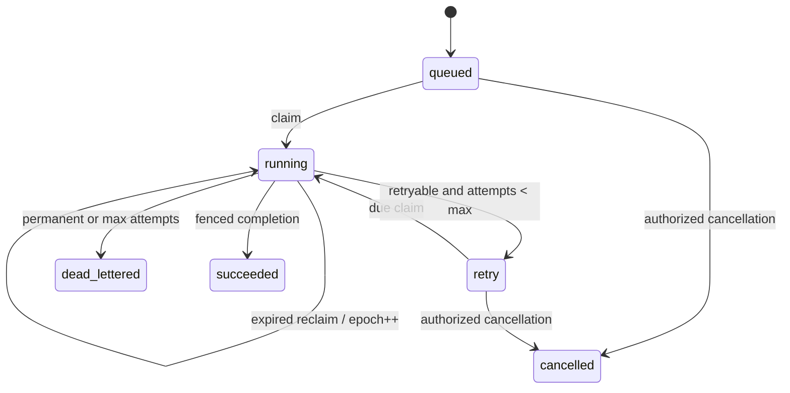

# R03.51 — Package Ingestion Worker Lease, Fencing & Retry

- Date: 2026-11-02
- Status: Reference DDL + PostgreSQL harness; verification pending
- Product Code Freeze: ACTIVE
- Parent: R03.49 / R03.50

## 1. Boundary

R03.49 defines the ingestion Session lifecycle. R03.50 persists Session, Transition, Receipt and session-sequenced Outbox atomically. R03.51 adds a durable Job queue and reference lease/fencing behavior. This is not a production worker, scheduler, broker relay, production migration, upload API, UI or Simulation Runtime. P3.17 remains out of scope.

The DDL assumes the R03.50 sessions table with composite key (tenant_id, session_id). The Python harness uses a disposable schema and role.

## 2. Job model

Job primary key is (tenant_id, job_id), with a tenant-aware FK to Session. A Session may have multiple Job Types; a partial unique index allows only one active Job per (tenant, session, job_type), where active means queued/running/retry. Different Job Types can be claimed concurrently. Session writes remain serialized by Session row lock and expected revision.

Fields: package identity/version, type, status, priority, payload, attempt_count, maximum_attempts, available_at, lease_owner, lease_expires_at, lease_epoch, safe error metadata, completed_at and timestamps. lease_epoch is a monotonically increasing fencing token.

## 3. Lease and fencing

- Claim uses READ COMMITTED, a short transaction, ORDER BY priority/availability/creation/id and SELECT FOR UPDATE SKIP LOCKED. It increments attempt_count and lease_epoch, then writes owner and expiry.
- Lease comparisons use PostgreSQL clock_timestamp(), not worker wall clock or transaction-start now().
- Renewal requires status=running, matching tenant/job/owner/epoch, and an expiry strictly later than database time.
- Completion locks Job, verifies owner/epoch/unexpired lease, then locks Session and checks expected_revision. Session, Transition, Outbox and Job success commit together.
- Reclaim after expiry increments epoch. A late worker holding an old epoch is rejected at the database boundary.

Lease expiry alone is insufficient: a paused process may resume after another worker has reclaimed the job. Expiry determines eligibility; fencing rejects writes from an older generation. A token checked only in worker memory is not fencing.

### Fencing race

```mermaid
sequenceDiagram
  participant A as Worker A
  participant DB as PostgreSQL
  participant B as Worker B
  A->>DB: claim; epoch=7
  Note over A: process pauses past lease expiry
  B->>DB: reclaim with row lock
  DB-->>B: owner=B; epoch=8
  A->>DB: complete with epoch=7
  DB-->>A: STALE; no writes
  B->>DB: complete with epoch=8
  DB-->>B: commit if lease remains valid
```

## 4. State and retry



Attempt count increments once per claim, not on failure. A worker crash consumes the attempt already started. Retry persists available_at; workers must not sleep while holding a lease.

For attempt n >= 1: ceiling(n) = min(max_backoff, initial_backoff * 2^(n-1)); full jitter selects Uniform(0, ceiling(n)). The current harness accepts delay_seconds as an input; centralized retryable-error taxonomy, jitter policy/version and production scheduler remain OPEN.

Non-retryable errors or attempts >= maximum_attempts enter DLQ. Persist stable error codes and bounded, redacted messages only. Raw exception strings, credentials, archive bytes and signed URLs must not be stored. DLQ replay is not implemented; recommended replay creates a new Job ID, retains original evidence, requires authorization/audit and enforces a replay ceiling.

## 5. Transaction consistency

Successful completion is one transaction: lock Job and verify fence; lock Session and compare revision; update Session; append Transition; insert R03.50 Outbox event; mark Job succeeded and clear lease; commit. Any failure rolls back all writes. Same-epoch duplicate completion after success is a no-op. Stale or expired completion cannot mutate Session or Outbox.

Retry and DLQ alter Job state only and do not fabricate a Session transition. A complete event relay for every Job-only state change is not implemented; do not reuse Session revision numbers for unrelated Job events.

## 6. Tenant and external side effects

RLS uses ENABLE/FORCE and transaction-local app.tenant_id. This is defense in depth, not an independent trust boundary against arbitrary SQL or compromised application credentials; DEC-19 remains OPEN. Composite tenant FKs do not replace authorization.

Fencing only protects resources that validate the token. It cannot undo an email, object-store write, third-party API call or message already emitted by a stale worker. Such effects require idempotency, downstream fencing or compensation.

## 7. Operational candidates (not production tuning)

| Parameter | Candidate |
|---|---:|
| Lease duration | 60 s |
| Heartbeat interval | 15 s |
| Claim batch | 1 initially |
| Clock authority | PostgreSQL |
| Polling | bounded backoff |
| Shutdown | stop claiming; finish/renew bounded work; otherwise allow lease expiry |

Priority ordering can starve low-priority jobs; production may need aging or per-tenant fair share. No worker supervision, graceful drain, metrics, tracing, broker integration or production connection-pool reset is implemented.

## 8. Status

Reference DDL and harness only. No production Worker, production migration, broker relay, DLQ replay authorization, downstream fencing adapter or production retry policy. DEC-19, DEC-27, DEC-28 and DEC-29 remain OPEN.
