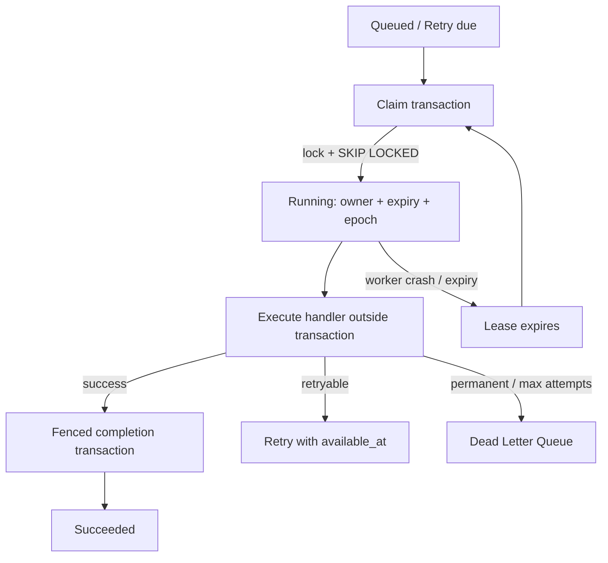

# R03.51 Worker Protocol Sequence Diagrams

- Status: Design diagrams aligned to the R03.51 reference harness; not production runtime evidence.

## 1. Worker Job Lifecycle



## 2. Lease acquisition, renewal and expiry

```mermaid
sequenceDiagram
  participant W as Worker
  participant DB as PostgreSQL
  W->>DB: BEGIN; select due row FOR UPDATE SKIP LOCKED
  DB-->>W: candidate job row
  W->>DB: increment epoch/attempt; set owner and DB expiry
  W->>DB: COMMIT
  loop heartbeat before expiry
    W->>DB: UPDATE lease WHERE owner + epoch match AND expiry > clock_timestamp()
    DB-->>W: renewed expiry or no row
  end
  Note over DB: At expiry, renewal is rejected even before reclaim
  DB->>DB: another worker may reclaim and increment epoch
```

## 3. Retry, backoff and DLQ

```mermaid
flowchart TD
  E[Worker reports error] --> V{Lease owner + epoch + expiry valid?}
  V -->|no| S[Reject stale failure report]
  V -->|yes| R{Retryable?}
  R -->|no| D[Dead-letter transaction]
  R -->|yes| M{attempt_count < maximum_attempts?}
  M -->|no| D
  M -->|yes| B[Compute capped exponential ceiling]
  B --> J[Full jitter Uniform(0, ceiling)]
  J --> A[Persist retry + available_at; clear lease]
  A --> Q[Wait for due claim]
  D --> T[Terminal DLQ record]
```

## 4. Job / Session / Transition / Outbox completion transaction

```mermaid
sequenceDiagram
  participant W as Worker
  participant DB as PostgreSQL
  W->>DB: BEGIN
  W->>DB: SELECT Job FOR UPDATE
  DB-->>W: verify running + owner + epoch + DB expiry
  W->>DB: SELECT Session FOR UPDATE
  DB-->>W: verify expected_revision
  W->>DB: UPDATE Session status/revision
  W->>DB: INSERT append-only Transition
  W->>DB: INSERT R03.50 Outbox event
  W->>DB: UPDATE Job succeeded; clear lease
  W->>DB: COMMIT
  Note over DB: Any write failure rolls back all four objects
```

## 5. Worker crash recovery

```mermaid
sequenceDiagram
  participant A as Worker A
  participant DB as PostgreSQL
  participant B as Worker B
  A->>DB: Claim and commit epoch 11
  A->>A: Start handler
  Note over A: Process crashes; no release request
  Note over DB: Job remains running until database lease expiry
  B->>DB: Claim expired Job
  DB->>DB: Lock row; increment epoch to 12; assign B
  DB-->>B: New lease
  A->>DB: (if restarted) late completion with epoch 11
  DB-->>A: Reject stale epoch
  B->>DB: Complete with epoch 12
  DB-->>B: Commit if lease and Session revision remain valid
```

## Consistency notes

- Claim, renewal, reclaim, failure and completion all require bounded database transactions.
- No handler work or external network call is performed while holding a Job row lock.
- PostgreSQL clock is authoritative for lease decisions.
- Fencing works only when the protected write validates the current epoch.
- At-least-once execution remains; external effects need idempotency or downstream fencing.
