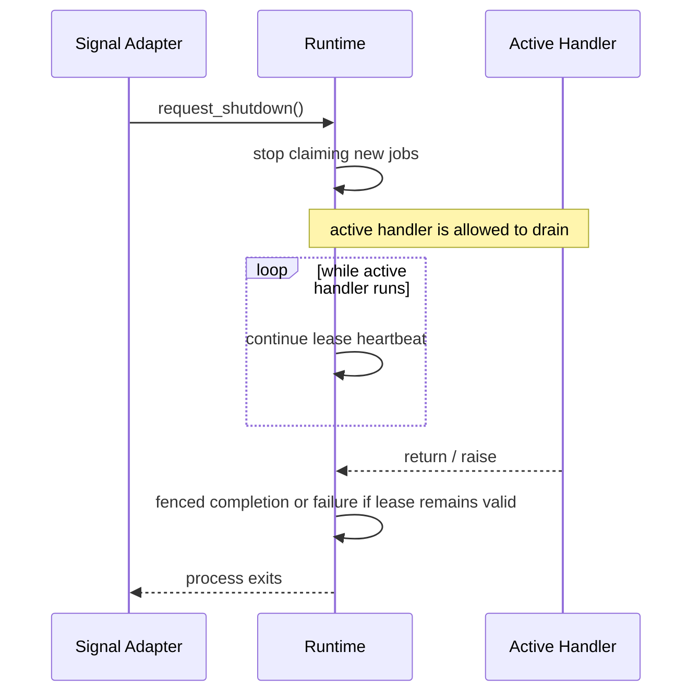

# R03.52.1 Worker Runtime Lifecycle Sequence

- Status: Reference protocol diagram; aligned to adapter-neutral runtime core.

## Normal execution and heartbeat loss

```mermaid
sequenceDiagram
  participant R as Runtime
  participant S as Store Adapter
  participant H as Handler
  R->>S: claim(worker_id, lease_duration)
  S-->>R: Job + owner + epoch
  par Handler execution
    R->>H: execute(Job, JobContext)
  and Lease heartbeat
    loop before lease expiry
      R->>S: renew(Job, owner, epoch)
      alt renewed
        S-->>R: true
      else false or exception
        S-->>R: lease lost
        R->>R: set lease_lost; fail closed
      end
    end
  end
  alt handler success and lease valid
    R->>S: complete(Job, result)
    S-->>R: fenced applied or stale
  else lease lost
    R->>R: suppress complete/fail mutation
    Note over S: lease expires; another worker may reclaim
  end
```

## Graceful shutdown



The signal adapter and bounded process supervisor are not implemented in this increment.
