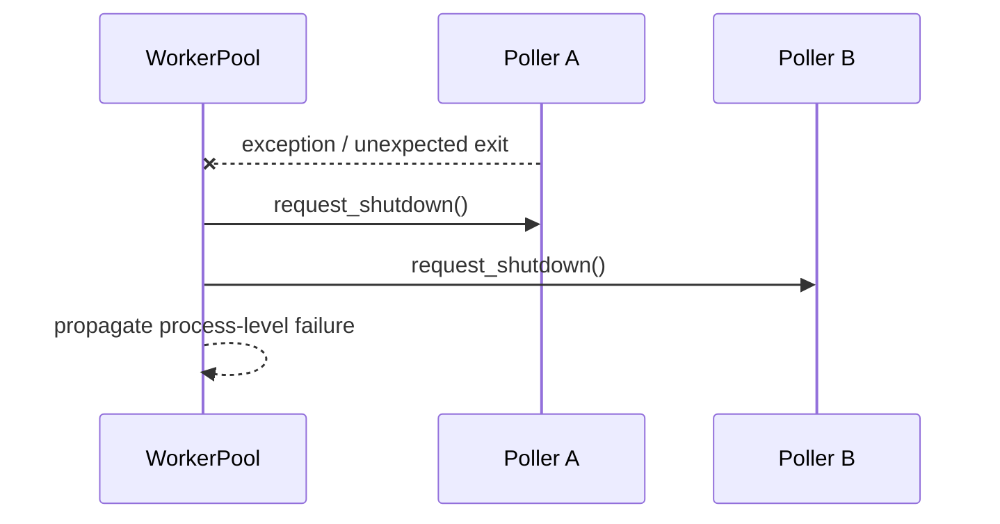

# R03.52.2 Worker Pool Supervision Sequences

- Status: Design diagram for the process-local reference pool.

## Startup, bounded polling and shutdown

```mermaid
sequenceDiagram
  participant P as Process Entrypoint
  participant Pool as WorkerPool
  participant W1 as Poller Slot 1
  participant WN as Poller Slot N
  participant Store as Durable Store
  P->>Pool: run(concurrency=N)
  Pool->>Pool: validate unique worker identities
  Pool->>W1: submit run_forever()
  Pool->>WN: submit run_forever()
  par Bounded poller slots
    W1->>Store: claim / execute / heartbeat
  and
    WN->>Store: claim / execute / heartbeat
  end
  P->>Pool: request_shutdown()
  Pool->>W1: request_shutdown()
  Pool->>WN: request_shutdown()
  Note over W1,WN: Stop new claims; active jobs drain with lease heartbeat
  W1-->>Pool: exited
  WN-->>Pool: exited
  Pool-->>P: run() returns
```

## Poller failure



This design does not implement process restart, signal delivery, or deployment health probes.
