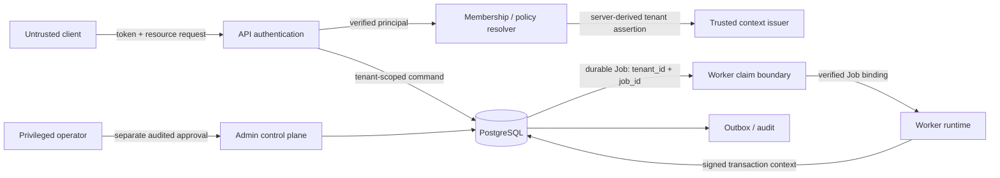

# R03.52.6.1 — Tenant Trust Boundary Threat Model

- Date: 2026-11-02
- Status: threat model v0.1; architecture proposal only; DEC-19 OPEN
- Baseline: main @ 04f450f7c33bb185b0dcf8e9ae1a714bc0b8773f
- Product Code Freeze: ACTIVE; P3.17: OUT OF SCOPE
- Security posture: fail-closed; production_ready=false

## 1. Security objective and assets

Prevent a principal operating for tenant A from reading, mutating, claiming, completing, replaying, or inferring tenant B data. Protected assets include tenant-owned rows, Job payloads/results, leases/fencing epochs, Inbox/Outbox, DLQ, replay/audit records, object references, and tenant-scoped operational metadata.

Security properties: tenant identity authenticity; principal-to-tenant membership; resource/action authorization; tenant binding across asynchronous boundaries; transaction-scoped database enforcement; no stale or cross-tenant writes; auditable privileged access.

## 2. Trust boundaries

Trust boundaries are the client/API boundary, principal/membership resolver, asynchronous Job boundary, Worker/Store boundary, connection-pool/transaction boundary, database role/RLS boundary, and privileged-operation boundary. PostgreSQL GUC is not a trust boundary: an application role that can execute arbitrary SQL can generally set a custom GUC.

## 3. Data-flow and identity lifecycle

1. Client authenticates with an approved identity provider. API validates signature, issuer, audience, expiry/not-before and key rotation under DEC-20; JWT validation itself remains OPEN.
2. API derives subject from the verified token. Client-supplied tenant_id/header/body is only a requested tenant selector.
3. A server-side membership/policy lookup proves subject has the requested action in the selected tenant. Missing, ambiguous, revoked or stale membership is denied.
4. The command persists tenant_id from the resolved server context. Resource ownership is checked with tenant-aware keys and authorization policy.
5. Job tenant_id is immutable database state. Payload tenant_id, if present for compatibility, is untrusted and must equal the persisted value or be rejected; it never overrides it.
6. Worker claim returns a persisted tenant/job binding. Worker verifies job type, owner, epoch, attempt, and tenant against the trusted claim result before handler dispatch.
7. Every Store operation binds the same tenant assertion to a single transaction and independently fences by tenant_id, job_id, lease_owner, epoch and database-clock expiry.
8. Transaction completion/rollback releases the context. A pooled connection must not carry tenant context into a later transaction.
9. Audit records capture authenticated actor/service principal, tenant, action, target, decision, reason/correlation ID and policy version; secrets and raw tokens are excluded.

## 4. Threat actors and capabilities

| Actor | Capability | Relevant risk |
|---|---|---|
| Malicious tenant user | Controls request body, headers, query, payload fields and replay timing | Tenant ID spoofing, object-IDOR, confused deputy |
| Compromised API process | Executes SQL using application DB credential | Can set GUC; can exploit broad DB grants |
| Malicious/compromised Worker | Controls Job payload and handler inputs; may retain stale lease | Cross-tenant claim/complete, stale side effects |
| Queue/broker attacker | Reorders, duplicates, injects or replays messages | Payload tenant substitution and replay |
| Pool/transaction bug | Reuses physical connection across requests | Context leakage |
| Privileged operator | Has exceptional cross-tenant access | Unbounded system-level access and weak audit |
| Database administrator | Superuser/owner-level control | Outside ordinary RLS protection; requires infrastructure controls and audit |

## 5. Attack scenarios and controls

| ID | Attack path | Required control | Current evidence / status |
|---|---|---|---|
| TB-01 | Client sends tenant_id=B while principal belongs only to A | Resolve tenant from verified principal + membership; deny mismatch | NOT_IMPLEMENTED at API boundary |
| TB-02 | Client forges X-Tenant-ID / body tenant | Treat as selector only; server overwrites from resolved context | NOT_IMPLEMENTED |
| TB-03 | Job payload changes tenant_id | DB Job row is authority; payload mismatch rejects before handler | NOT_IMPLEMENTED in production Worker |
| TB-04 | Worker claims A Job then completes B Job | Store writes predicate tenant+job+owner+epoch+DB expiry; composite FK | R03.51 reference fencing exists; adversarial cross-tenant store test NOT_IMPLEMENTED |
| TB-05 | App role sets GUC to B | Signed/otherwise DB-verifiable assertion or stronger role boundary; narrow grants | GUC-only is VULNERABLE by design; executable proof added in R03.52.6 |
| TB-06 | Missing tenant context | RLS returns no rows / writes denied; application rejects before SQL | RLS behavior needs integration evidence |
| TB-07 | Pool connection reused after tenant A | SET LOCAL / set_config(...,true) inside transaction; rollback/commit cleanup | R03.52.6 PostgreSQL harness |
| TB-08 | Tenant A transaction rolls back then connection reused by B | Context is transaction-local; rollback clears context | R03.52.6 PostgreSQL harness |
| TB-09 | SECURITY DEFINER bypasses RLS | No generic tenant-facing definer; fixed search_path, no PUBLIC execute, explicit tenant arg + independent verification | Production functions NOT_IMPLEMENTED |
| TB-10 | Worker uses privileged/system role for convenience | Separate control-plane identity, explicit action/resource scope, approval and append-only audit | NOT_IMPLEMENTED |
| TB-11 | Expired lease owner completes | Database-clock expiry + owner + epoch predicate | R03.51 reference tests; production adapter NOT_IMPLEMENTED |
| TB-12 | Replay authorization from stale/forged actor fields | Reauthorize against trusted principal and source row inside replay transaction | R03.52.5 preflight only; persistence NOT_IMPLEMENTED |
| TB-13 | Tenant assertion replayed in another transaction/job | Short expiry, audience, subject, tenant, action, resource/job binding, nonce; one transaction only | PROPOSED; no production issuer/verifier |
| TB-14 | Connection role has BYPASSRLS or table owner bypass | Runtime role NOLOGIN/NOSUPERUSER/NOBYPASSRLS; FORCE RLS; no ownership | Test harness role only; production grants NOT_VERIFIED |

## 6. RLS, application authorization and database roles

- Application authorization answers whether a verified principal may perform an action on a resource. RLS is not a replacement for this decision.
- RLS is a database-level row filter and write check, valuable against omitted predicates and many application defects.
- A custom GUC is caller-controlled state unless a separate mechanism authenticates its value. Transaction-local scope prevents leakage; it does not prevent spoofing within the transaction.
- Composite tenant-aware primary/foreign keys enforce relational ownership consistency, not caller identity.
- Runtime roles must not be superuser, table owner, or BYPASSRLS. FORCE ROW LEVEL SECURITY is defense in depth, not protection against superuser/DBA.
- SECURITY DEFINER is a privileged code boundary. Prefer none in tenant-facing paths. If unavoidable: fixed search_path, schema-qualified references, minimal owner, no dynamic SQL, revoked PUBLIC execute, strict argument validation and independent context verification.
- System-wide operations must not be represented by a magic tenant ID or empty GUC. They require a distinct service principal and an explicit capability/action with bounded target scope and audit.

## 7. Fail-closed matrix

| Condition | Required result |
|---|---|
| Missing/invalid/expired assertion | Reject before tenant data access |
| Token principal differs from resolved actor | Reject |
| Membership absent/revoked/ambiguous | Reject |
| Job tenant differs from asserted tenant | Reject and quarantine/audit security event |
| Payload tenant differs from persisted Job tenant | Reject; never trust payload |
| Context tenant conflicts with transaction/job | Roll back |
| RLS context absent | No rows; writes fail |
| Signature/key/audience/expiry validation fails | Reject; no fallback to GUC-only |
| System capability absent | Reject privileged operation |
| Lease stale/expired/epoch mismatch | No state mutation or external success |
| Pool reset/rollback uncertain | Discard connection; do not return it to pool |

## 8. Residual risks and assumptions

A compromised context issuer, API/Worker process holding a signing secret, database superuser, malicious DBA, vulnerable SECURITY DEFINER function, or arbitrary SQL plus unrestricted data-plane grants can defeat parts of this design. The proposed assertion is not a substitute for process isolation, secret management, least privilege, SQL parameterization, egress controls, audit monitoring, and incident response. These residual risks require a deployment threat model.

## 9. Verification boundary

R03.52.6 adds a real PostgreSQL test that demonstrates (a) missing GUC fails closed, (b) transaction-local context clears on commit/rollback and connection reuse, and (c) an application role can spoof a plain GUC and read another tenant. The last test is an expected vulnerability demonstration, not a passing security claim. Signed assertion code is a contract/reference prototype only. Cross-tenant Worker claim/complete, real pool integration, issuer compromise, SECURITY DEFINER review and production grants remain NOT_IMPLEMENTED/NOT_VERIFIED.
