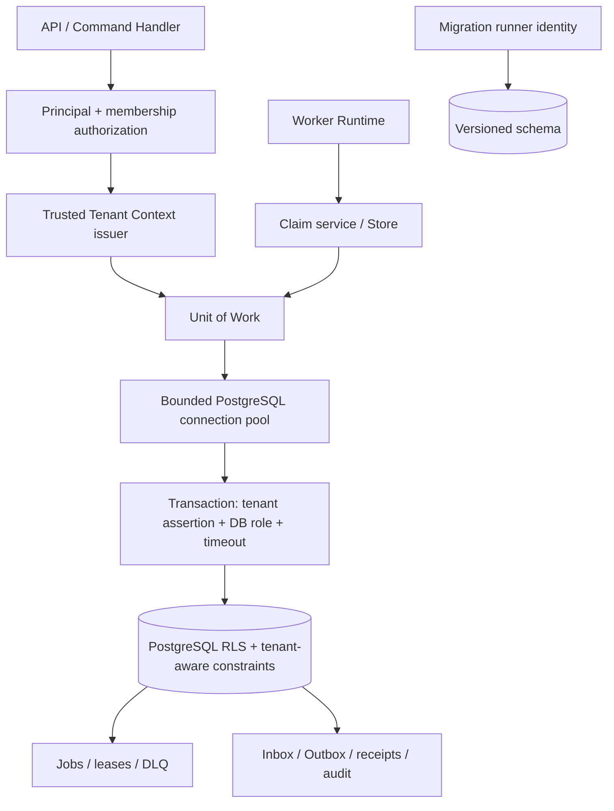

# R03.52.6.3 — Production Store Architecture

- Status: candidate architecture; DEC-04 OPEN
- Related: DEC-03, DEC-05, DEC-13, DEC-19, DEC-30
- Production implementation: NOT_IMPLEMENTED

## 1. Logical architecture



## 2. Store boundary

Define a language-neutral Store contract before selecting a driver:

- `claim(worker_identity, capability, lease_duration) -> ClaimedJob | None`
- `renew(tenant, job, owner, epoch, lease_duration) -> LeaseResult`
- `complete(tenant, job, owner, epoch, result_ref) -> FencedWriteResult`
- `fail(tenant, job, owner, epoch, stable_error_code, retry_decision) -> FencedWriteResult`
- `replay(source_job, actor, reason, idempotency_key, authorization) -> ReplayReceipt`
- `append_audit(actor, tenant, action, target, decision, correlation_id) -> AuditReceipt`

Every mutation is tenant-scoped and fenced in SQL by persisted tenant_id, job_id, lease_owner, lease_epoch and database-clock lease expiry. Store methods never accept tenant identity from arbitrary Job payload. The Worker Runtime depends on a protocol/interface, not psycopg or pool internals.

## 3. Transaction boundary

- Claim: short transaction; set verified context; SELECT eligible row FOR UPDATE SKIP LOCKED; increment epoch/attempt; set owner and expiry using database clock; commit before handler dispatch.
- Renew: short transaction; exact tenant/job/owner/epoch and unexpired lease predicate; database clock; return false on zero rows.
- Complete/fail: one transaction for fenced Job transition plus result/receipt, DLQ/audit and Outbox changes that must be atomic. External side effects are never assumed atomic with PostgreSQL; use idempotency/outbox.
- Replay: one transaction reauthorizes actor and source row, locks DLQ/Job, checks replay ceiling and idempotency, inserts new Job, increments replay counter, writes immutable audit and Outbox.
- Handler execution: outside DB transaction; never hold row locks or a checked-out connection during scientific computation.
- Tenant context is established and consumed inside the same transaction. No session-scoped SET; use transaction-local state only.

```mermaid
sequenceDiagram
  participant W as Worker
  participant S as Store
  participant P as Pool
  participant D as PostgreSQL
  W->>S: claim(worker identity)
  S->>P: acquire bounded connection
  P->>D: BEGIN + install verified tenant assertion
  D->>D: verify context; RLS; SKIP LOCKED claim + epoch++
  D-->>S: persisted tenant/job/owner/epoch
  S-->>W: ClaimedJob
  Note over W: handler executes without DB transaction
  W->>S: complete(tenant, job, owner, epoch)
  S->>P: acquire connection
  P->>D: BEGIN + rebind same verified context
  D->>D: fenced UPDATE with DB clock; atomic audit/outbox
  D-->>S: applied or stale
  S-->>W: result
```

## 4. Connection pool and lifecycle

Candidate pool requirements (library/vendor OPEN):
- bounded max_size, min_size, acquisition timeout and queue bound;
- explicit connection and statement timeout; TCP keepalive and server idle transaction timeout;
- checkout/checkin health check; broken connections discarded;
- transaction context manager always rollback on exception/cancellation;
- no connection retained while handler runs;
- context installed transaction-locally and verified cleared after commit/rollback;
- pool shutdown stops acquisition, drains checked-out connections to a deadline, then closes;
- capacity budget includes API, Worker replicas, migration, admin and observability connections; reserve emergency/admin capacity;
- pool exhaustion is backpressure, not permission to create unbounded connections.

## 5. Driver and pool evaluation (DEC-04 OPEN)

Candidate Python driver: psycopg 3 (sync and async APIs, PostgreSQL-native behavior, prepared statements and pipeline support). Candidate pool: psycopg_pool. Alternatives to benchmark include asyncpg with its pool and SQLAlchemy 2.x async engine/pool. No candidate is selected.

Selection criteria: cancellation behavior, transaction nesting, connection reset, server-side cursor behavior, prepared statement interaction with PgBouncer transaction pooling, COPY support, observability hooks, type adaptation, maintenance, supported Python versions, pool fairness and failure recovery.

Python remains a reference runtime only. DEC-03 is OPEN; production Worker language/runtime must be selected independently of the Store contract.

## 6. Migration lifecycle

- Use a dedicated migration identity, separate from runtime roles; runtime role receives no DDL.
- Migration artifact is immutable, checksummed, ordered and reviewed; record schema version in DB.
- Expand/contract: add nullable/new structures, deploy code compatible with old+new, backfill in bounded batches, add constraints concurrently where supported, switch reads/writes, then remove old structures in a later release.
- Backward-compatible migrations are forward-only in normal production operations. Rollback means application rollback while schema remains compatible, or a separately reviewed compensating migration; never assume destructive DDL can be safely reversed.
- Migration lock/advisory lock prevents concurrent runners. Startup workers do not auto-run migrations.
- Test upgrade from previous schema, interrupted migration, rerun/idempotency, backup restore and rollback/forward-fix.

## 7. Errors, retries and observability

Classify connection acquisition timeout, network interruption, server restart, query cancellation, statement timeout, deadlock (40P01), serialization failure (40001), unique conflict, RLS denial, stale lease and schema mismatch separately. Retry only safe idempotent transactions; use bounded exponential backoff with jitter and total deadline. Do not transparently retry a transaction after an ambiguous commit unless idempotency receipt resolves outcome. Cancellation must rollback and discard a connection if protocol state is uncertain.

Emit pool wait/size/in-use/idle, transaction duration, query duration, timeout, deadlock, serialization retry, connection reset/discard, claim latency, lease renewal latency, stale fencing, RLS denial and per-tenant fairness metrics. Avoid tenant identifiers or secrets as unbounded metric labels.

## 8. Existing reference evidence and gaps

R03.50 PostgreSQL harness validates disposable schema transaction/RLS/Inbox/Outbox behavior; R03.51 validates disposable Job lease/fencing/retry/DLQ behavior. R03.52.1–.5 are Python orchestration/preflight references. None is a production migration, connection pool, Store adapter, authenticated tenant issuer, production worker or broker relay.

## 9. DEC-04 decision gates

- D1: confirm PostgreSQL version/support policy and managed/self-hosted operational constraints.
- D2: benchmark driver/pool candidates under cancellation, contention, pool exhaustion and failover.
- D3: approve transaction/UoW API and error/retry classification.
- D4: approve migration tooling, locking, expand/contract and restore procedure.
- D5: prove tenant context and RLS under real pool reuse and adversarial SQL.
- D6: run multi-process Worker claim/renew/complete/fail/fencing and crash-recovery tests.
- D7: capacity/latency/load test and observability review.
- D8: named architecture/security/operations approval.

Until gates are passed, DEC-04 remains OPEN; PostgreSQL 17 is only the current CI integration target.


## 8. DEC-04 / DEC-19 decision boundary

The target Store architecture principles are ACCEPTED: language-neutral Store protocol; explicit Unit of Work; short bounded transactions; no checked-out DB connection during handler execution; bounded pool/acquisition queue/timeouts; distinct runtime, migration and audited administrative identities; immutable checksummed migrations; expand/contract rollout; migration locking and restore tests.

The tenant context design is ACCEPTED only as a target: application authorization + independently issued scoped assertion + mandatory database-side cryptographic verification in the RLS path + tenant-aware constraints and Worker fencing. A raw caller-set GUC is not trusted. The database verifier's implementation/crypto profile is deliberately not selected here.

Production implementation remains gated on DEC-03 runtime selection, PostgreSQL/driver/pool/migration evaluation, database verifier adversarial proof, issuer/key custody, pool cancellation/reset/failover, cross-tenant Worker Store tests, migration interruption/restore/compatibility, capacity and operational sign-off. No production-ready claim follows from this architecture approval.
