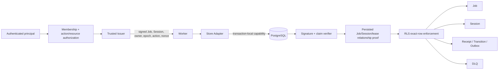

# R03.52.7.3.5 — Resource-Scoped Assertion Contract Resolution

- Date: 2026-11-03
- Status: architecture resolution proposal; reference implementation NOT_STARTED
- Product Code Freeze: ACTIVE
- P3.17: OUT OF SCOPE
- R03.44: CONDITIONAL_NOT_READY; production_ready=false
- Baseline: main @ 80ac3118941de45a81f9b4ca8ed82934f5f2be5c
- Related: DEC-04 (approved principles), DEC-19 (approved target trust boundary), DEC-03 (OPEN), DEC-14 (OPEN), R03.52.7.2, R03.52.7.3.1–3.4

## 1. Executive Summary

### 1.1 Problem

The v1alpha1 `JobLease` contains `tenant_id`, `job_id`, `owner`, `epoch`, and `expires_at`, but no persisted `session_id`. A Complete operation is one atomic Unit of Work touching Job, Session, Receipt, Transition and Outbox. A Job-only assertion checked against each row's own identifier cannot authorize those related rows. A tenant-only predicate would widen authority to unrelated Sessions and Jobs and is rejected.

### 1.2 Resolution recommended for the next reference increment

Adopt a **single Job-rooted, versioned capability assertion**, with a database-verified relationship proof:

1. A new assertion contract version binds issuer/key ID, subject, tenant, audience, action, Job ID, persisted Session ID, Worker owner, lease epoch, issue/expiry time and nonce. The exact claim set is closed; unknown fields are rejected.
2. A matching versioned lease/result contract carries `session_id` as a convenience and consistency field. The signed assertion, not the mutable lease object or Worker payload, is the authority.
3. PostgreSQL verifies the signature and exact claim scope, then verifies the persisted Job row and its Job→Session relationship, owner, epoch, status and DB-clock lease validity. The target Session and child rows must match both the signed Session and the persisted Job relationship.
4. Receipt, Transition and Outbox rows carry tenant, job and session keys and are constrained by composite foreign keys. Their RLS authorization is derived from the same Job-rooted capability, not tenant membership alone.
5. The entire set of checks and mutations runs in one transaction. The Job row is locked first; related records follow the canonical lock order. The assertion is installed transaction-locally and cannot be carried to another transaction.
6. Nonce use is **one committed authorization transaction**, not one SQL statement. A durable nonce ledger is written in the same transaction as the protected operation. Business idempotency is separate and survives re-issuance of an assertion.

This is a design recommendation, not an approved production protocol or demonstrated implementation. It preserves the existing DEC-19 trust boundary and does not select a production crypto extension, database version, driver, pool, runtime or deployment topology.

### 1.3 Why this is preferred

It combines the clarity of a versioned assertion/lease contract with the integrity of database-side relationship verification. It avoids multiple independently signed capabilities that can be accidentally or maliciously cross-joined. Explicit Session binding narrows the capability; the database relationship check prevents the Issuer or caller from binding an unrelated Session to a Job.

### 1.4 Status summary

| Item | Resolution |
|---|---|
| Job/Session relationship | Signed Job-rooted capability + persisted DB relationship proof |
| Session ID in JobLease | Add in a new version; do not mutate v1alpha1 semantics |
| Assertion root | One Job capability per Worker operation |
| Child resource scope | Exact tenant + job + session + child resource identity |
| Owner/Epoch/Lease | Signed claims AND current persisted-row checks |
| Nonce | Durable transaction-scoped consumption, atomically committed |
| Idempotency | Separate durable business key + canonical request digest |
| Outbox dispatch | Separate dispatcher capability rooted at event/outbox ID |
| DLQ replay | Separate replay action/capability; never reuse the failed Worker's lease |
| Production implementation | NOT_STARTED |
| Production readiness | false |

## 2. Current Contract and Security Boundary

### 2.1 Verified current facts

The current Store Protocol defines a tenant-bound, single-use Unit of Work. Its public surface includes Claim, Renew, Complete and Fail; no generic SQL passthrough is exposed. The protocol states that tenant scope comes from an opaque signed access context, and cross-tenant work requires separate contexts and transactions.

The current `JobLease` in `runtime/store_protocol.py` and `contracts/worker-store-protocol.schema.v1alpha1.json` contains:
- `tenant_id`
- `job_id`
- `owner`
- `epoch`
- `expires_at`

It does not contain `session_id`. The Complete command includes expected Session revision, result reference, idempotency key and request digest, but it does not independently prove the Job→Session relationship.

The Ed25519 reference verifier validates a signed, closed claim set containing `v`, `iss`, `kid`, `tenant_id`, `sub`, `aud`, `action`, `resource_id`, `iat`, `exp`, and `nonce`. It validates issuer key status, signature, time bounds, tenant, audience, action and resource. The current reference verifier does not consume the nonce.

The R03.52.7.3.4 design describes a single tenant assertion context per UoW and explicitly identifies the missing resource-scope proof for Session and related rows.

### 2.2 Trust boundary

Application authorization remains the first decision point:
- authenticate the principal;
- resolve tenant membership server-side;
- authorize action and resource;
- resolve persisted Job/Session relationship;
- issue a short-lived signed capability.

The database independently verifies cryptographic authenticity and current database state. RLS is the final row-level enforcement point. A caller-controlled GUC is only a carrier for the token, never proof of identity or authority.

Composite tenant-aware keys and foreign keys enforce relational consistency; they do not authenticate the caller. SQL predicates written by the adapter are not a substitute for RLS. A signed assertion alone does not prove that the resource relationship or lease remains current.

### 2.3 Trust boundaries and exclusions

This design is intended to resist malicious tenant users, compromised ordinary API/Worker processes with bounded runtime credentials, stale Workers, message duplication/reordering and application predicate omissions. It does not claim protection against database superuser/host compromise, trusted Issuer compromise, verifier-owner compromise, malicious trusted administrators or arbitrary unreviewed privileged database code.

## 3. Threat Model

| Threat | Attack | Required control |
|---|---|---|
| Cross-tenant IDOR | Tenant A supplies Tenant B Job/Session/Receipt ID | Signed tenant + RLS row tenant check + composite keys |
| Same-tenant Job substitution | Job A capability accesses Job B | Exact signed Job ID and DB Job row match |
| Same-tenant Session substitution | Job A capability accesses unrelated Session B | Signed Session ID AND persisted Job.session_id equality |
| Cross-job child splice | Receipt/Transition/Outbox for another Job is accessed | Child row job_id/session_id must match capability and FK |
| Owner spoof | Worker changes owner field in payload/lease | Signed owner plus persisted lease_owner comparison |
| Epoch rollback | Old Worker reuses old epoch | Signed epoch plus current persisted epoch comparison |
| Lease extension spoof | Worker changes expires_at | DB clock is authoritative; client timestamp is not accepted as proof |
| Stale assertion | Valid signature after lease loss/reclaim | Current Job row lock + status/owner/epoch/DB expiry |
| Issuer confused deputy | Issuer signs arbitrary client-provided Session | Issuer resolves relationship from trusted persisted data; DB rechecks |
| Assertion substitution | Token A placed in transaction for Job B | Exact action/resource/tenant/audience/owner/epoch checks |
| Multi-assertion splice | Valid Job assertion combined with unrelated Session assertion | One Job-rooted capability; if multi-capability ever used, common signed operation binding required |
| Replay | Same signed token reused in another transaction | Durable nonce ledger with unique key, atomic with operation |
| Ambiguous commit | Client cannot tell if operation committed | Receipt/idempotency reconciliation using same operation key and fresh read capability |
| Pool leakage | Token/GUC survives connection reuse | SET LOCAL/transaction-local setting, reset/discard on uncertain state |
| Privileged path | Definer helper bypasses RLS or exposes arbitrary reads | Dedicated NOLOGIN verifier role, narrow functions, fixed search_path, grant audit, no generic SQL |

## 4. Resource Access Matrix

The table describes the recommended Worker/Store contract. “Exact” means the resource identity is constrained by the signed capability and current database relationship, not just by a caller SQL predicate.

| Resource | Claim | Renew | Complete | Fail/Retry/DLQ | Replay | Outbox dispatch |
|---|---|---|---|---|---|---|
| Worker assignment | Read exact worker assignment | — | — | — | Replay principal policy | Dispatcher assignment |
| Job | Candidate row lock + assign | Exact Job update | Exact Job lock/update | Exact Job lock/update | Source Job read; new Job create as authorized | Related Job metadata only if required |
| Session | — | — | Exact persisted Session lock/update | — unless policy explicitly requires | Exact source Session read / target relationship | — |
| Receipt | — | — | Insert/read exact idempotency receipt | Operation receipt if defined | Replay receipt/audit | — |
| Transition | Claim transition if modeled | Append exact Job transition | Append exact Job/Session transition | Append exact Job transition | Append replay transition | — |
| Outbox | Claim event if modeled | — | Insert exact Job/Session event | Insert retry/DLQ event | Insert replay event | Exact event lock/update |
| DLQ | — | — | — | Insert/update exact Job DLQ record | Lock/read exact DLQ item | — |
| Nonce ledger | Consume transaction capability | Consume transaction capability | Consume transaction capability | Consume transaction capability | Consume replay capability | Consume dispatcher capability |

Every row also requires tenant equality. For all Job-rooted rows, the exact Job and Session relationship must be verified. A tenant ID is a necessary partition key, never a sufficient authorization scope.

## 5. Three Candidate Designs

### 5.1 A — Versioned Assertion / Lease Contract Extension

Extend the versioned JobLease and assertion with `session_id`.

**Strengths**
- The required resource scope is explicit and inspectable.
- One capability expresses the entire Worker operation authority.
- Issuer can bind the complete resource tuple before the Worker receives it.
- RLS can compare each target row with the same signed Job/Session scope.
- A new schema version makes the semantic change explicit.

**Weaknesses**
- Signed Session ID alone cannot prove the database relationship is still true.
- A Job may be reassigned or its Session relationship changed unless immutable/guarded.
- If owner/epoch are absent from the signed assertion, the lease fields remain mutable caller data.
- A contract-only change without DB relationship checks is insufficient.

**Assessment:** necessary contract improvement, but not sufficient by itself. It should be combined with B.

### 5.2 B — Database-side Relationship Verification

Keep the capability rooted at Job. A restricted database verifier resolves the current persisted Job and proves the target Session/child row belongs to that Job.

**Strengths**
- Database state is authoritative for Job→Session relationship.
- Prevents a caller from substituting an arbitrary Session within the same tenant.
- Current owner, epoch, status and DB-clock expiry can be checked close to the mutation.
- Supports child-resource checks using tenant/job/session composite identity.

**Weaknesses**
- A helper that reads protected tables can create RLS recursion or become a privileged bypass.
- A broad SECURITY DEFINER function can become an authorization oracle or privilege-escalation surface.
- The Job relationship and lock order must be explicit.
- Rechecking in a helper and later mutating without appropriate locks creates TOCTOU.

**Required implementation shape:** a narrowly scoped, non-generic verifier/helper. It accepts a closed set of expected identifiers and action; it does not accept arbitrary SQL, table names, policy expressions or caller-selected tenant context. Its execution role is NOLOGIN/NOSUPERUSER/NOBYPASSRLS, not a data-table owner, and has only the minimum explicit read privileges required. If a verifier-only RLS policy is needed to avoid recursive evaluation, it must be restricted to the dedicated verifier role and its exposure reviewed as a privileged code boundary. Runtime must not assume that role or execute general-purpose helper functions.

The helper must lock/validate the Job within the same transaction as the protected operation, or operate under a rigorously defined lock protocol that makes the relationship and lease stable through commit.

**Assessment:** strongest database-side proof, but only if implemented with a reviewed privilege graph and lock discipline. An ordinary SQL WHERE clause is not B.

### 5.3 C — Multiple Resource-scoped Assertions

Issue separate Job, Session and possibly child-resource assertions for one UoW.

**Strengths**
- Each token can be independently narrow.
- Different issuer policy domains can be separated.
- A resource may be authorized without granting authority to the whole Job graph.

**Weaknesses**
- A transaction may combine valid but unrelated tokens (Job A + Session B).
- The database needs a common signed operation/transaction binding, not merely independent valid signatures.
- Issuance, refresh, storage, logging and expiry become more complex.
- Atomic nonce consumption across several assertions requires a single transaction ledger.
- More verifier calls and more complicated error/recovery semantics.

If retained as a future option, every token must bind the same `operation_id`, tenant, subject, audience, action set, Job ID, Session ID, expiry window and transaction intent; the verifier must reject mismatched sets. That largely recreates a single aggregate capability.

**Assessment:** not recommended for the current Worker Store. Use only when independently delegated resource authorities are a real product requirement.

## 6. Additional Candidate Designs

### 6.1 Single Job-rooted capability with DB relationship proof

This is the recommended composition of A+B. One token binds Job and Session. PostgreSQL verifies both the cryptographic claims and the persisted Job→Session mapping. Child records must carry both IDs.

This minimizes token count while ensuring that neither the Worker nor a caller-supplied Session ID can widen access.

### 6.2 Transaction-scoped authorization context

Install the signed capability in a transaction-local setting, then let RLS and helper functions read it. This is a transport/context mechanism, not a separate authorization design. It is safe only when every policy independently verifies the token and the context cannot persist across transactions. A plain GUC containing tenant ID remains insufficient.

### 6.3 Persisted capability/lease projection

A private, transactionally maintained projection could hold the current Job/Session/owner/epoch/expiry tuple for efficient verification. It may reduce joins, but introduces a second state representation and consistency burden. It is not needed for the first reference implementation. Consider only after measured evidence shows relationship verification is a bottleneck and prove that updates to Job and projection are atomic.

### 6.4 Materialized resource hierarchy / capability graph

A generic resource graph could support more complex nested resources, but adds policy language, graph consistency and cache invalidation risks. The current relation is simple (Job→Session; children→Job/Session), so a generic hierarchy is unjustified.

### 6.5 Database-only opaque transaction handle

A trusted function could create a DB-side transaction context and return an opaque handle. The handle must still be bound to the authenticated subject, tenant, action, Job, Session, owner, epoch and expiry; it also needs transaction affinity and replay semantics. This adds state and connection coupling without removing the need for the same proofs. Not preferred.

## 7. Security Analysis

### 7.1 Recommended claim profile (proposed v2)

The exact wire format remains an implementation decision. The semantic claim set should be closed and include:

| Claim | Meaning | Verification |
|---|---|---|
| `v` | Assertion contract version | Exact supported value |
| `iss`, `kid` | Trusted issuer and key ID | Keyring status, validity and revocation |
| `sub` | Authenticated subject/service principal | Issuer authorization and audit |
| `tenant_id` | Resolved tenant | Exact expected tenant and row tenant |
| `aud` | Intended Store/DB audience | Exact configured audience |
| `action` | One operation action | Exact action; no wildcard |
| `job_id` | Root Job | Exact target and persisted Job |
| `session_id` | Related Session | Exact target and persisted Job.session_id |
| `owner` | Worker lease owner | Exact persisted lease_owner |
| `epoch` | Lease generation | Exact persisted lease_epoch |
| `iat`, `exp` | Issuance and expiry | DB clock, bounded lifetime |
| `nonce` | Unique assertion/authorization instance | Durable ledger |
| `operation_id` | Stable logical operation identifier | Binds retries/reconciliation; not a substitute for idempotency key |

No `tenant-wide`, wildcard resource or wildcard action claim is permitted for Worker Store operations. If Claim does not yet have a Job ID, it uses a distinct Claim capability bound to the worker assignment and eligible job type scope; Claim returns a persisted Job lease, after which the Issuer issues a Job-rooted capability for subsequent operations.

### 7.2 Required database predicates

For Renew, Complete, Fail and retryable state transitions, database validation must establish all of:

- token signature and issuer key validity;
- exact token version, tenant, audience, action, Job ID, Session ID, owner and epoch;
- persisted Job tenant and ID match;
- persisted Job Session ID equals signed Session ID;
- persisted owner equals signed owner;
- persisted epoch equals signed epoch;
- persisted state permits the requested action;
- `lease_expires_at > clock_timestamp()`;
- target child row (where applicable) has the same tenant, Job and Session;
- the operation has not already been consumed with a conflicting idempotency key/digest.

The signed `exp` bounds the assertion lifetime. It does not replace the DB-clock lease check. The client-provided `expires_at` in JobLease is informational only and must not determine authorization.

### 7.3 RLS policy shape

Conceptual only; not production SQL:

```sql
USING (
  security.verify_job_capability(
    current_setting('app.job_assertion', true),
    tenant_id, job_id, session_id, 'complete'
  )
)
```

The verifier must validate the signature and persisted relationship; it cannot merely compare the signed values with the target row. For Session, whose row may not contain job_id, the verifier resolves the signed Job and proves `job.session_id = session.session_id`. For Receipt/Transition/Outbox, require tenant/job/session columns and composite FKs.

For INSERT policies, WITH CHECK must validate the same complete scope. UPDATE must validate both USING (old row) and WITH CHECK (new row) so an update cannot move a row across a resource boundary.

### 7.4 Privileged helper safety

A SECURITY DEFINER helper is a privileged boundary, not an automatic safe shortcut. Requirements:
- dedicated NOLOGIN owner, NOSUPERUSER, NOBYPASSRLS, no table ownership;
- fixed safe search_path and schema-qualified references;
- no dynamic SQL and no caller-selected relation names;
- strict input length/type/enum validation;
- no key material disclosure;
- no generic “verify arbitrary token then return tenant” API;
- explicit EXECUTE grants, revoked PUBLIC;
- no runtime membership in helper owner;
- minimal SELECT rights to required relationship columns;
- no recursive policy path or undocumented FORCE RLS bypass;
- audited function ownership and grant inventory.

If a narrow internal policy is required for the verifier role to read the relationship table, document it as a dedicated privileged read path and test that ordinary runtime cannot assume the role or call arbitrary SQL as it. Avoid granting BYPASSRLS to make the implementation convenient.

### 7.5 Resource graph invariants

Recommended relational constraints:
- Job primary/unique key includes `(tenant_id, job_id)`.
- Job stores non-null `session_id` for operations requiring a Session.
- Session primary/unique key includes `(tenant_id, session_id)`.
- Job has a composite FK `(tenant_id, session_id) -> Session(tenant_id, session_id)`.
- Receipt, Transition and Outbox each store `tenant_id, job_id, session_id`.
- Each child has a composite FK to Job `(tenant_id, job_id, session_id)` or an equivalent unique Job key that includes session_id.
- Immutable history rows are append-only to runtime; Outbox dispatch state changes are separately scoped.
- A Job's Session association is immutable after creation unless an explicit privileged migration/administrative workflow is designed. Normal Worker operations cannot re-parent a Job.

## 8. Nonce and Replay Semantics

### 8.1 Threat model distinctions

| Case | Definition | Required semantics |
|---|---|---|
| Assertion replay | Same signed token submitted again | Reject as a new transaction after committed nonce use |
| Reuse inside one transaction | Same token authorizes multiple SQL statements of one UoW | Allowed; one transaction-level authorization |
| Reuse across transactions | Same token starts a second UoW | Deny if nonce already committed |
| Commit outcome unknown | Connection lost during COMMIT | Reconcile by durable operation receipt; do not blindly replay |
| Client retry | Client repeats same logical request | New assertion nonce, same business idempotency key/digest |
| Idempotent request replay | Same operation key and same digest | Return original durable outcome; no duplicate effects |
| Idempotency conflict | Same key, different digest | Reject with IDEMPOTENCY_CONFLICT |
| Lease renewal | Owner renews current lease | New action-scoped assertion/nonce; DB validates current owner/epoch/expiry |
| Stale owner | Previous Worker resumes after reclaim | Reject due to persisted epoch/owner mismatch regardless of token signature |

### 8.2 Recommended nonce lifecycle

Use a durable nonce ledger with a uniqueness constraint such as `(issuer, kid, nonce)`. The ledger records assertion version, tenant, subject, action, Job/Session, owner/epoch, operation_id, first-seen transaction metadata and retention deadline. Do not store raw bearer tokens.

Within the protected transaction:
1. verify signature and claim scope;
2. lock and validate current Job/Session relationship and lease;
3. insert nonce-ledger row under unique constraint;
4. perform the authorized Store mutation;
5. commit the nonce ledger and business writes atomically.

A nonce collision means the assertion has already been consumed or concurrently submitted. Fail closed; do not silently treat a second transaction as an idempotent duplicate. Idempotent business replay is handled by the Receipt, not by reusing the same nonce.

A single assertion may be evaluated by several RLS policies/statements in the same transaction. The verifier must not consume the nonce on every policy call. Consumption belongs to a transaction-level authorization step, and RLS checks must validate that the transaction has an active authorization record for the exact capability. The design must prevent callers from fabricating that record; it must be written only through a narrowly granted verifier/authorization function.

### 8.3 Atomicity and transaction identity

PostgreSQL does not provide a generic trusted application-level “transaction ID” that should be treated as a security capability. A transaction-local context may carry a random `operation_id`, but the database must bind it to the signed assertion and a durable nonce ledger row. The transaction-local marker is not independently trusted.

If an authorization helper inserts a nonce ledger row, that insert must occur in the same transaction as the protected business changes. A rollback rolls back both. A commit persists both. The unique constraint serializes concurrent use of the same nonce.

### 8.4 Ambiguous commit recovery

- The adapter returns TRANSACTION_OUTCOME_UNKNOWN and discards the connection.
- It does not reuse the same assertion nonce for a fresh transaction.
- A fresh, narrowly scoped reconciliation assertion is issued for the same subject/tenant/Job/Session and operation ID.
- Reconciliation reads the durable Receipt (or operation result ledger) by the stable idempotency key and verifies the canonical request digest.
- If a matching Receipt exists, return the original outcome.
- If the key exists with another digest, return IDEMPOTENCY_CONFLICT.
- If no committed Receipt exists, retry only with a new assertion nonce and the same idempotency key/digest. The Job row lock and unique receipt key serialize races with a transaction whose COMMIT outcome was previously unknown.
- If the database cannot establish a conclusive state, preserve TRANSACTION_OUTCOME_UNKNOWN and escalate; do not assume rollback.

### 8.5 Retention and cleanup

Nonce records must outlive the maximum assertion lifetime, clock-skew allowance, transaction recovery window and audit investigation window. Cleanup is bounded, partitioned/batched and performed by a separate maintenance identity. Do not delete records while a matching transaction may still be in flight. Keep a minimal tombstone or uniqueness horizon if replay risk extends beyond detailed audit retention. Retention duration is an OPEN operational/security decision and must be set before production.

## 9. TOCTOU and Transaction Isolation

### 9.1 Canonical lock order

For Complete:
1. Job row `FOR UPDATE`;
2. Session row `FOR UPDATE`;
3. Receipt uniqueness/row arbitration;
4. Transition append;
5. Outbox append;
6. Job terminal update (same locked Job).

The exact implementation may insert Receipt before Session mutation to reserve idempotency, but the order must be fixed across all adapters and all competing paths. No path may lock Session then Job if Complete locks Job then Session. Deadlock retries are permitted only when the failed transaction is known rolled back and a fresh assertion/nonce is used.

### 9.2 Relationship stability

Locking Job first stabilizes owner, epoch, state and session_id against concurrent reclaim or mutation. The Session lock serializes revision updates. Composite FKs prevent child records from referencing a mismatched Job/Session pair. The database helper and the write must execute in the same transaction; a preflight query outside the transaction is not sufficient.

### 9.3 Clock semantics

Use PostgreSQL `clock_timestamp()` for lease expiry and lease extension decisions. `now()` / `transaction_timestamp()` is fixed at transaction start and can be stale in long transactions. Assertion `iat/exp` verification may use a documented DB-clock timestamp source; lease fencing specifically uses current DB wall clock at the guarded mutation.

### 9.4 Isolation level

Do not select a production isolation level in this stage. Row locks, unique constraints, composite FKs and conditional updates are mandatory regardless of level. The reference tests should exercise the intended default isolation and a stronger isolation candidate if useful, with serialization failures classified and retried only after confirmed rollback. The benchmark must compare identical semantics, not silently change isolation per driver.

### 9.5 RLS and statement execution

Every statement touching protected tables must execute under the same transaction-local verified capability. A helper check performed under one connection/transaction cannot authorize another. Missing, malformed, expired, wrong-action or mismatched context denies. A context reset failure causes connection discard.

## 10. Worker Owner/Epoch/Lease Fencing

- Claim increments epoch monotonically in the same transaction that persists owner and expiry.
- Claim returns a lease only after commit.
- Issuer signs the exact persisted Job, Session, owner and epoch after successful claim; it must not sign values copied only from the queue payload.
- Renew/Complete/Fail require signed owner/epoch and equality with the locked current Job row.
- Lease expiry is checked using DB clock inside the mutation transaction.
- Reclaim changes owner and increments epoch. Any old capability then fails even if its signature and exp are still valid.
- Renewal does not change epoch; it updates expiry only if the current owner/epoch still match and the lease has not expired.
- A renewal assertion is action-specific and fresh. The previous assertion cannot be repurposed for Complete.
- Client-side `expires_at` is informational. It never overrides DB expiry.
- Worker must stop external side effects after a lease-loss signal. For external side effects that cannot be transactionally fenced by PostgreSQL, use idempotent downstream APIs/outbox delivery and document the residual race.

## 11. Atomic Unit-of-Work Authorization

### 11.1 Complete flow

```mermaid
sequenceDiagram
    autonumber
    participant W as Worker
    participant I as Trusted Issuer
    participant S as Store Adapter
    participant P as PostgreSQL
    participant V as DB Verifier
    participant R as RLS
    participant J as Job
    participant SS as Session
    participant C as Receipt/Transition/Outbox

    W->>I: Request capability for persisted claimed Job
    I->>P: Resolve Job + Session + current owner/epoch
    P-->>I: Persisted relationship and lease snapshot
    I-->>W: Signed Job+Session+owner+epoch capability
    W->>S: Complete command + capability + idempotency key
    S->>P: BEGIN; SET LOCAL assertion
    S->>P: Lock Job FOR UPDATE
    P->>V: Verify signature, audience, action and claims
    V->>J: Check persisted tenant/job/session/owner/epoch/status
    V->>P: Check DB-clock lease expiry
    P->>R: Evaluate row policy for Job
    R-->>P: Permit exact Job row only
    S->>P: Lock exact Session; compare revision
    P->>V: Verify Session is persisted Job.session_id
    P->>R: Evaluate Session/child RLS policies
    R-->>P: Permit exact related resources only
    S->>P: Consume nonce + Receipt + Transition + Outbox + Job update
    P-->>S: COMMIT
    S-->>W: APPLIED / DUPLICATE / conflict
```

### 11.2 Trust relationship



### 11.3 Atomicity rules

- All database mutations for one logical Complete operation commit or roll back together.
- Nonce consumption and business writes share the same transaction.
- No handler computation, object storage I/O, event publishing or network call occurs while holding the DB transaction.
- Outbox dispatch is asynchronous and at-least-once; consumer idempotency is required.
- A failed statement aborts the transaction; no partial Receipt/Transition/Outbox state may survive.
- A connection with uncertain transaction state is discarded.

## 12. Performance and Complexity Analysis

| Design | Signature checks | Relationship reads | Token/issuer complexity | RLS complexity | Risk |
|---|---:|---:|---|---|---|
| A only | Low–medium | Low | Medium | Medium | Signed but stale/false relation unless DB verifies |
| B only | Low | Medium | Low | High | DB must infer all related scope; verifier privilege complexity |
| C multiple tokens | High | Medium | High | High | Token splice and nonce-set complexity |
| Job-rooted A+B | Low–medium | One locked Job relationship + exact target checks | Medium | Medium–high | Best security/complexity balance |
| Generic capability graph | Variable/high | Potentially high | High | Very high | Overengineering for current relation |
| Opaque DB handle | Low after issue | State lookup | High statefulness | Medium–high | Connection/transaction coupling |

Performance must be measured only after semantic correctness. The benchmark should record:
- signature verification latency and calls per UoW;
- Job relationship lookup/lock time;
- RLS policy evaluation overhead per table;
- nonce-ledger insert contention and cleanup overhead;
- Receipt unique-key conflict path;
- p50/p95/p99 by operation;
- lock waits, deadlocks, WAL and index size;
- hot-Job contention and tenant fairness.

Do not cache a successful lease check across transactions. Any optimization must preserve current-row owner/epoch/expiry validation.

## 13. Failure and Recovery Semantics

| Failure | Required behavior |
|---|---|
| Missing/malformed token | Deny; no fallback |
| Signature/key/revocation failure | Deny and security audit |
| Wrong tenant/action/audience/resource | Deny |
| Job→Session mismatch | Deny; integrity/security event |
| Owner/epoch mismatch | STALE; no writes |
| Lease expired by DB clock | EXPIRED; no writes |
| Nonce already committed | Reject new transaction; use idempotency reconciliation |
| Duplicate idempotency key + same digest | Return prior outcome |
| Duplicate key + different digest | IDEMPOTENCY_CONFLICT |
| Session revision mismatch | Roll back all writes |
| Failure after any write | Roll back all changes including nonce ledger |
| Connection loss during COMMIT | TRANSACTION_OUTCOME_UNKNOWN; discard connection |
| Worker crash after Claim commit | Lease expires; next Claim reclaims and increments epoch |
| Old Worker resumes | Current epoch/owner check denies |
| Outbox publish succeeds but mark-published fails | Event may be delivered again; consumer deduplicates by event_id |
| Pool reset uncertain | Discard connection |
| Verifier internal error | Fail closed; safe generic error; preserve restricted diagnostics |

## 14. Compatibility and Versioning

### 14.1 Do not mutate v1alpha1

The current v1alpha1 schema rejects unknown properties and does not include Session ID. Adding a required field in place would be a breaking semantic change and risks mixed-version ambiguity.

Create a new contract version (proposed `v1alpha2` or a separately named capability schema) with:
- JobLease.session_id;
- signed Job/Session/owner/epoch binding;
- explicit operation/action scope;
- operation_id and nonce semantics;
- closed claim/property set;
- explicit audience and maximum assertion lifetime.

The exact version label is a proposal, not a final decision. Do not issue a v1alpha1 token and infer Session scope from caller input.

### 14.2 Rollout

1. Add schema and reference types for the new version without changing production behavior.
2. Add verifier tests and RLS integration tests for v2.
3. Add explicit version negotiation; unsupported versions fail closed.
4. Ensure issuer and Store adapter accept only a configured version.
5. Migrate consumers only after compatibility tests and a security review.
6. Retire v1 only after all issuers, Workers and adapters have moved; never silently downgrade.
7. Keep v1alpha1 contract tests unchanged as historical compatibility tests.

No production rollout is authorized in this stage.

## 15. Decision Matrix

Scores: 1 = weak, 3 = adequate with controls, 5 = strongest. Scores compare candidate architecture shapes, not implementation evidence.

| Dimension | A only | B only | C | Job-rooted A+B |
|---|---:|---:|---:|---:|
| Least privilege | 4 | 4 | 4 | 5 |
| Resource binding | 4 | 4 | 4 | 5 |
| Cryptographic integrity | 5 | 5 | 5 | 5 |
| Replay resistance | 2* | 2* | 2* | 5** |
| Epoch fencing | 3 | 5 | 3 | 5 |
| Atomicity | 4 | 5 | 3 | 5 |
| TOCTOU resistance | 2 | 4 | 3 | 5 |
| Failure recovery | 3 | 3 | 2 | 5 |
| Operational complexity | 4 | 2 | 1 | 3 |
| Performance potential | 5 | 3 | 2 | 4 |
| Auditability | 4 | 4 | 3 | 5 |
| Versionability | 5 | 3 | 3 | 5 |

* A/B/C do not inherently define nonce consumption; score reflects the candidate alone before adding a replay protocol.  
** Job-rooted A+B can meet this score only with the nonce ledger and idempotency separation defined in Section 8. This is not yet implemented or tested.

The recommended composition is not the simplest in raw SQL count, but it has the clearest security proof while avoiding the operational complexity of multi-token joins.

## 16. Recommended Architecture

### 16.1 Contract

Use one action-scoped Job-rooted capability per Worker UoW. Bind:
`tenant + subject + audience + action + job + session + owner + epoch + iat + exp + nonce + operation_id`.

Add Session ID to the next JobLease version as a consistency field. The signed capability and persisted DB row remain authoritative.

### 16.2 Database enforcement

- Verify signature and key lifecycle using the approved verifier boundary.
- Validate current Job relationship and lease fields in PostgreSQL.
- Use a Job-first lock order.
- Enforce target Session equality with persisted Job.session_id.
- Enforce child resource tenant/job/session equality through RLS and composite FKs.
- Consume nonce transactionally.
- Keep runtime role NOSUPERUSER, NOBYPASSRLS, non-owner and without DDL/key-management rights.
- Fail closed on all verifier errors.

### 16.3 Operation capability separation

Do not use one broad token for every Store action. Issue action-specific capabilities:
- Claim: worker assignment + allowed job types + audience + nonce; no arbitrary tenant selector.
- Renew: exact Job/Session/owner/epoch + renew action.
- Complete: exact Job/Session/owner/epoch + complete action + operation ID.
- Fail: exact Job/Session/owner/epoch + fail action.
- Replay: separate authorized replay principal/action rooted at the exact DLQ record/source Job; creates a new Job/epoch, never resurrects the old lease.
- Outbox dispatch: separate dispatcher capability rooted at event_id/outbox record; does not inherit Worker Job write authority.

### 16.4 Explicit non-decisions

This resolution does not select:
- production PostgreSQL major version;
- pgsodium or another production crypto extension;
- production Issuer/KMS/HSM design;
- production verifier ownership/deployment topology;
- runtime, driver, pool or migration framework;
- transaction isolation level;
- nonce/audit retention duration;
- external event delivery guarantee beyond the existing Outbox boundary.

## 17. Open Decisions

| ID | Decision | Recommendation | State |
|---|---|---|---|
| R535-OD1 | Approve Job-rooted capability + DB relationship proof as target contract | Approve this composition for reference implementation | Product/security owner approval required |
| R535-OD2 | Add session_id to next JobLease version | Required; do not alter v1alpha1 | Proposed |
| R535-OD3 | Assertion v2 exact claim set and operation_id semantics | Adopt Section 7.1 | Proposed |
| R535-OD4 | Nonce ledger retention and audit retention | Set from threat/recovery policy before production | OPEN |
| R535-OD5 | Internal verifier role and RLS relationship-read path | Dedicated NOLOGIN least-privilege role; separate security review | OPEN |
| R535-OD6 | Outbox dispatcher and DLQ replay capability contracts | Separate action/resource capabilities | Proposed |
| DEC-03 | Runtime/driver selection | No change | OPEN |
| DEC-14 | Deployment/provider topology | No change | OPEN |
| DEC-19 | Approved trust-boundary principles | Preserve | ACCEPTED |
| DEC-04 | Approved architecture principles | Preserve | ACCEPTED |

No approval of DEC-03 or DEC-14 is implied. No change to product freeze or R03.44 status is implied.

## 18. Required Tests

All authorization tests must run against real PostgreSQL with RLS enabled and forced, the database-side Ed25519 verifier path, runtime non-owner role and realistic grants. Mock tests may supplement but cannot satisfy these gates.

| ID | Adversarial / correctness case | Expected result |
|---|---|---|
| T01 | Cross-tenant Job/Session/child resource | Deny |
| T02 | Same-tenant different Job | Deny |
| T03 | Same-tenant different Session | Deny |
| T04 | Forged Job→Session association in token | Deny against persisted relation |
| T05 | Owner claim spoof | Deny |
| T06 | Epoch claim spoof | Deny |
| T07 | Expired DB lease with valid assertion | Deny |
| T08 | Modified signature | Deny |
| T09 | Action claim mutation | Deny |
| T10 | Resource ID mutation | Deny |
| T11 | Wrong audience | Deny |
| T12 | Same assertion reused in same UoW | Allowed only for same transaction/action/scope |
| T13 | Same nonce committed then used in another transaction | Deny |
| T14 | Concurrent duplicate nonce use | Exactly one authorization transaction succeeds |
| T15 | Multiple assertion splice (Job A + Session B) | Deny |
| T16 | Mid-transaction failure after nonce insert | Full rollback; nonce not consumed |
| T17 | Commit ambiguous then reconcile | One durable outcome; no duplicate side effects |
| T18 | Worker crash after Claim commit | Lease later reclaimable |
| T19 | Old Worker resumes after new Claim | Old epoch denied |
| T20 | Duplicate Receipt same digest | Return DUPLICATE |
| T21 | Duplicate Receipt different digest | IDEMPOTENCY_CONFLICT |
| T22 | Outbox dispatch repeated | At-least-once delivery; consumer deduplication |
| T23 | RLS bypass/role escalation attempt | Permission denied |
| T24 | Pool reuse after commit/rollback/cancel | No context leakage |
| T25 | Verifier helper search_path/temp-table shadow | No behavior change |
| T26 | Verifier role attempts arbitrary access | Denied outside explicitly granted path |
| T27 | Job Session relationship mutation during Complete | Blocked by lock/immutability constraint |
| T28 | Two Complete transactions race same Job | Serialized; one logical completion |
| T29 | Claim uses unassigned worker or unsupported type | Deny/no row |
| T30 | Claim uses `FOR UPDATE SKIP LOCKED` under contention | No duplicate lease assignment |

### 18.1 Operation conformance matrix

| Operation | Root/action | Resource scope | Required DB checks |
|---|---|---|---|
| Claim | Worker assignment / claim | Exact worker assignment and eligible job type set; tenant from trusted context | Persisted assignment, supported type, queue state, DB-clock availability, SKIP LOCKED, owner set, attempt increment, epoch increment |
| Renew | Job / renew | Exact Job + Session + owner + epoch | Current Job relation, owner/epoch, running state, DB-clock unexpired lease; update expiry using DB clock |
| Complete | Job / complete | Job + exact Session + Receipt + Transition + Outbox | Job-first lock, persisted relation, owner/epoch/expiry, Session revision, nonce, idempotency digest, atomic writes |
| Fail | Job / fail | Exact Job + Transition (+ Receipt if defined) | Owner/epoch/expiry, stable error code, action idempotency |
| Retry | Job / retry | Exact Job + Transition + Outbox | Failure authorization, retry policy result, DB-clock available_at, attempt/max attempts, epoch fencing |
| Dead-letter | Job / dead_letter | Exact Job + DLQ + Transition + Outbox | Owner/epoch, terminal predicate, atomic DLQ and Job terminal state |
| Replay | DLQ item / replay | Exact DLQ record + source Job; newly created Job | Replay principal policy, exact DLQ/source relation, idempotency, new Job/epoch, audit/outbox; no old lease reuse |
| Outbox dispatch | Event / dispatch | Exact event_id/outbox row | Dispatcher identity, event claim/lock, DB-clock lease if used, idempotent publish key, mark-published after publish |
| Idempotent retry | Operation/Receipt / reconcile | Exact tenant + operation idempotency key + digest + Job/Session | Fresh read/reconcile capability, same digest, Receipt result; no reuse of consumed nonce |

### 18.2 Test environment and evidence rules

- Use the pinned disposable PostgreSQL + Ed25519 verifier fixture for reference tests; do not infer production extension approval from this.
- Run as a real non-superuser login mapped to a NOSUPERUSER/NOBYPASSRLS runtime role.
- Force RLS on all protected tables; test table owner and verifier-owner privilege paths separately.
- Keep negative tests that prove vulnerabilities rejected; do not remove tests to obtain green CI.
- Record exact PostgreSQL/extension image, schema, grant inventory, test count and commit SHA.
- CI success is evidence for the tested fixture only, not production readiness.

## 19. Implementation Roadmap

### R03.52.7.3.6 — Resource-Scoped Authorization Reference Implementation & PostgreSQL Security Tests

Entry criteria:
- Product/security owner accepts the recommended contract direction or explicitly selects an alternative.
- Exact v2 claim/schema shape and action vocabulary are frozen for the reference fixture.
- Privileged helper/RLS recursion strategy is reviewed.
- Nonce ledger semantics and idempotency behavior are testable.

Work sequence:
1. Add v2 assertion and JobLease schemas/types without changing v1alpha1.
2. Add deterministic test Issuer support with private key confined to the test process.
3. Add disposable PostgreSQL DDL for Job, Session, Receipt, Transition, Outbox, DLQ and nonce ledger.
4. Implement narrowly scoped verifier/helper functions and RLS policies.
5. Add composite FKs and immutable Job→Session relationship constraints.
6. Add transaction-level nonce consumption and operation Receipt.
7. Implement Claim/Renew/Complete/Fail/Retry/DLQ/Replay/Outbox reference operations only.
8. Run the full adversarial matrix and fault injection.
9. Audit roles, grants, SECURITY DEFINER ownership/search_path and all alternate access paths.
10. Benchmark only after correctness gates pass.

No production Store Adapter is authorized by this roadmap. It is a reference implementation and security test increment only.

## 20. Evidence and References

### Repository evidence inspected at baseline

- `docs/architecture/R03.52.7.3.4-full-store-workload-benchmark-design.md` — Full Store workload and identified Job/Session assertion gap.
- `docs/architecture/R03.52.7.2-store-protocol-unit-of-work-contract.md` — Store/UoW semantics, lock/fencing/idempotency/ambiguous commit contract.
- `runtime/store_protocol.py` — v1alpha1 JobLease and Store protocol reference types.
- `contracts/worker-store-protocol.schema.v1alpha1.json` — closed v1alpha1 schema; no session_id.
- `docs/architecture/R03.52.7.1-database-tenant-assertion-verifier-spike.md` — HMAC and Ed25519 verifier reference evidence and limits.
- `scripts/test_postgres_tenant_ed25519_verifier.py` — real PostgreSQL Ed25519 verifier tests.
- `scripts/test_postgres_tenant_assertion_verifier.py` — HMAC verifier reference tests.
- `docs/architecture/R03.52.6.1-tenant-trust-boundary-threat-model.md` — tenant trust boundary and residual risk.
- `.github/workflows/contract-validation.yml` — current contract and PostgreSQL verifier CI paths.

### CI evidence at baseline

- Main HEAD `80ac3118941de45a81f9b4ca8ed82934f5f2be5c`.
- Contract Validation Run #41475655552 completed SUCCESS on that HEAD.
- Previous main runs for R03.52.7.3.4 also completed SUCCESS; the intermediate failed run #41474507097 is retained as audit history and is not represented as passing.
- The current workflow has a PostgreSQL service for contract tests and a separate PostgreSQL 17.11 + pgsodium 3.1.11 verifier/benchmark job. These are reference test environments, not a production platform selection.

### Standards and technical references

- PostgreSQL Row Security Policies: https://www.postgresql.org/docs/current/ddl-rowsecurity.html
- PostgreSQL CREATE POLICY: https://www.postgresql.org/docs/current/sql-createpolicy.html
- PostgreSQL CREATE FUNCTION / SECURITY DEFINER considerations: https://www.postgresql.org/docs/current/sql-createfunction.html
- PostgreSQL Explicit Locking: https://www.postgresql.org/docs/current/explicit-locking.html
- PostgreSQL Transaction Isolation: https://www.postgresql.org/docs/current/transaction-iso.html
- PostgreSQL Date/Time Functions and `clock_timestamp()`: https://www.postgresql.org/docs/current/functions-datetime.html
- PostgreSQL INSERT / ON CONFLICT: https://www.postgresql.org/docs/current/sql-insert.html
- PostgreSQL Constraints and Foreign Keys: https://www.postgresql.org/docs/current/ddl-constraints.html

### Evidence classification

**Verified facts:** repository files, current v1alpha1 fields, verifier claim profile, verifier's non-consuming nonce behavior, R03.52.7.3.4 workload scope, current CI workflow and baseline run status.

**Technical derivations:** Job-rooted A+B capability is the narrowest practical composition for the current Job→Session→child-resource graph; row locks plus DB-clock checks and transactionally consumed nonce close the identified stale-owner and cross-resource windows if implemented correctly.

**Unverified assumptions:** the proposed verifier role can be granted the exact minimal read path without recursion or alternate bypass; the selected production database crypto profile supports the required verifier; actual contention/performance remains acceptable.

**Pending approvals:** v2 assertion/lease contract, nonce retention, verifier role/RLS internal read path and any production crypto/deployment decisions.

---

**Stage conclusion:** the resource-scope gap now has a concrete recommended contract and a testable security proof plan. This document does not claim that the proof has been executed. Product Code Freeze remains ACTIVE, P3.17 remains OUT OF SCOPE, DEC-03/DEC-14 remain OPEN, and production_ready remains false.
