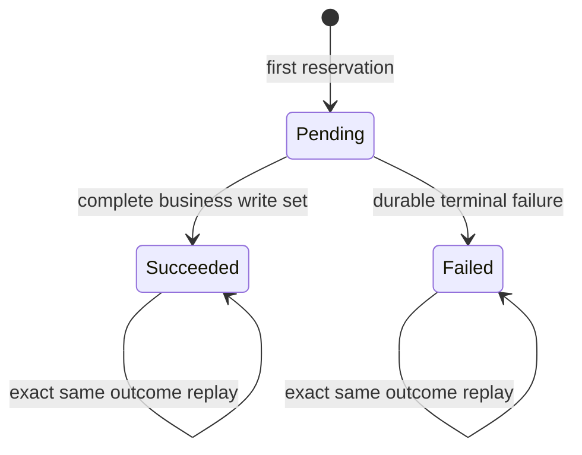

# Receipt, Idempotency and Nonce Contract Audit

**Version:** 0.1.0  
**Status:** SOURCE AUDIT / CONTRACT NOT ACCEPTED  
**As-of:** 2026-11-03  
**Gates:** G5 OPEN; G6 OPEN

## 1. Receipt helper facts

The disposable v2alpha2 Receipt table has a generated primary key; idempotency uniqueness on `(tenant_id, action, idempotency_key)`; operation uniqueness on `(tenant_id, operation_id)`; status check `pending | succeeded | failed`; digest syntax check; nullable JSONB outcome; and timestamps.

Reservation inserts a pending row with `ON CONFLICT (tenant_id, action, idempotency_key) DO NOTHING`. On same-key conflict it selects the existing row `FOR UPDATE`, compares the digest, and returns stored status/outcome. Different digest raises `IDEMPOTENCY_CONFLICT`; a unique violation is mapped to `OPERATION_ID_CONFLICT`. Finalization permits pending-to-terminal and exact same terminal replay; conflicting finalization is rejected.

This helper is independent of Job, Session, Nonce, Transition, Outbox and DLQ writes.

## 2. Receipt fixture identity defect

The PostgreSQL test reserves the first Receipt with `operation-1`, then retries the same idempotency key with `operation-retry` while reusing the same literal digest. The concurrent first-use test similarly uses two different operation IDs with one literal digest.

The canonical Request Envelope includes `operation_id`. A correctly recomputed digest for a changed operation ID must differ. These fixtures do not represent retries of the same signed request and cannot prove identity/digest binding.

**Required correction:** a same-request retry preserves the exact operation ID, tenant, action, resource type/id, idempotency key, arguments and digest. Changed operation ID/resource/tenant/action must be treated as a different request and rejected if paired with the original digest.

## 3. Additional helper-level gaps

1. On idempotency-key conflict the helper compares digest but does not independently compare stored operation_id, resource_type or resource_id. It returns stored identity fields. An integrated Handler must prohibit inconsistent identity/digest tuples.
2. The helper does not calculate or verify the digest; it trusts the caller-supplied digest.
3. Pending Receipt visibility/recovery is unspecified. A committed pending row may be observed on replay, but no lease/owner/timeout/recovery rule exists in this helper.
4. The test proves rollback of Receipt reservation only; it does not prove rollback of Job, Session, Nonce, Transition, Outbox or DLQ together.
5. Broad unique-violation mapping should be reviewed if more unique constraints are added; errors should remain constraint-specific.
6. No Receipt retention/archival/deletion policy is present.
7. No privilege, PUBLIC EXECUTE, ownership or RLS acceptance is supplied.

## 4. Candidate Receipt state machine

This is a candidate only. The semantics of retryable failures and whether a terminal failed Receipt commits alongside a business failure must be decided. If an exception aborts the transaction, a newly inserted pending Receipt also rolls back; that behavior must be explicit.

## 5. Nonce Ledger: current evidence

The legacy reference fixture defines nonce uniqueness on `(issuer, kid, nonce)`. The legacy authorization path inserts the nonce in the same transaction and binds it to `pg_current_xact_id()`, token and resource identity. PR #20 records that this is a legacy path, not v2alpha2.

No v2alpha2 Handler currently inserts a durable nonce row. The Receipt helper does not interact with a Nonce Ledger. No source evidence establishes cross-version replay behavior.

## 6. Nonce decisions still OPEN

- **Uniqueness domain:** determine whether issuer/kid/nonce remains globally unique across assertion versions or a version-aware key is permitted. A version-aware key can enable cross-version replay unless proven otherwise.
- **Tenant/subject binding:** store tenant and subject for audit/correlation while defining the uniqueness scope explicitly.
- **Operation binding:** retain version, action, resource type/id, operation ID and digest for forensic checks.
- **Consumption:** after cryptographic and authorization validation, in the same transaction as the business write set; never commit nonce consumption separately before the business operation.
- **Replay result:** reusing the exact signed assertion after its nonce committed is rejected as `ASSERTION_REPLAYED`. A client retry re-issues the same immutable business Request Envelope (same operation_id, idempotency_key, action/resource and arguments, therefore the same digest) under a fresh nonce and signature; Receipt arbitration then returns the stored terminal outcome without repeating business mutation.
- **Rollback:** nonce insert rolls back with the UOW unless a separate anti-replay persistence policy is formally accepted and its consequences proven.
- **Concurrency:** unique constraint arbitrates same nonce on independent connections and across different actions/resources.
- **Retention:** define validity window, replay window, cleanup safety margin, key revocation interaction, audit retention and deletion authority.
- **Cross-version:** test v1alpha1/v2alpha1/v2alpha2 same nonce, same/different key, same/different operation, tenant variation and concurrent requests.
- **Legacy:** do not change legacy key, timing, transaction binding or error behavior without independent compatibility approval.

## 7. Cross-version threat matrix

| Attack | Expected result | Required evidence |
|---|---|---|
| v2alpha2 assertion at legacy entry | Reject; no fallback | Dispatch integration test |
| Legacy assertion at v2alpha2 entry | Reject; no fallback | Dispatch integration test |
| Same issuer/kid/nonce across versions | Reject or prove one shared uniqueness domain | Multi-version concurrent DB test |
| Same nonce, different action/resource | Reject; no second mutation | Nonce conflict + state snapshot |
| Same idempotency key, different digest | IDEMPOTENCY_CONFLICT | Receipt integration test |
| Same operation ID, different key | OPERATION_ID_CONFLICT | Receipt integration test |
| Same nonce/token in one transaction for another operation | Must not authorize second operation | Handler/nonce call graph test |
| Same business request retried after ambiguous response | Use a fresh reconciliation assertion nonce; return stored outcome only after matching Receipt/digest is found; never replay the old nonce | Full UOW replay test |
| Nonce cleanup races delayed retry | No replay acceptance outside documented policy | Retention/concurrency test |

## 8. Candidate transactional invariant

For a mutating v2alpha2 action, Receipt reservation, nonce consumption, resource mutation, Transition, Outbox (and DLQ where applicable), and Receipt finalization belong to one caller-owned database transaction. The caller must not commit unless the entire action result is valid. Broker/network delivery does not occur inside this transaction.

## 9. Gate conclusion

G5 and G6 remain OPEN. PR #19 proves helper-level uniqueness/arbitration behavior, but current replay fixtures are identity-inconsistent and no Handler/UOW or cross-version nonce contract is implemented.

## Change history

- 2026-11-03: Initial Receipt/Nonce audit based on PR #19 source and PR #20 audit.
