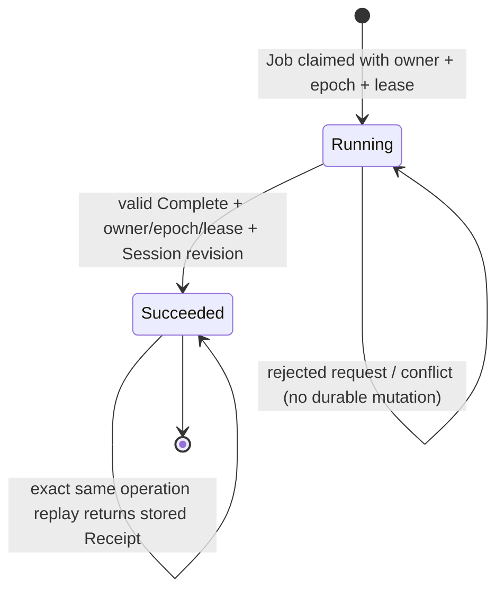

# worker.job.complete — Pre-Implementation Vertical Slice Design

**Version:** 0.1.0  
**Status:** DESIGN PROPOSAL / NOT ACCEPTED  
**As-of:** 2026-11-03  
**Gate:** G12 OPEN

## 1. Scope and baseline

This is the first proposed v2alpha2 business vertical slice. It is design-only. The current PR #13 reference Complete path uses the legacy assertion/authorization path and multiple RLS-protected direct Runtime statements. It is not a v2alpha2 atomic Handler.

The exact Complete business data model must be confirmed against the accepted Session/Job domain contract before mutation columns are frozen.

## 2. Candidate end-to-end sequence

```mermaid
sequenceDiagram
    autonumber
    participant C as Caller
    participant P as Strict Parser
    participant V as Trusted Signer / Version Dispatch
    participant H as Complete Handler
    participant DB as PostgreSQL
    C->>P: raw assertion bytes + typed request inputs
    P->>P: UTF-8, strict JSON, duplicate-key and size/depth checks
    P->>V: parsed envelope + raw payload/signature
    V->>V: resolve exactly one version verifier; verify issuer/key/signature
    V->>H: verified Claim (immutable identity)
    H->>H: validate action schema and build one typed binding
    H->>H: derive canonical digest from same typed binding used by mutations
    H->>H: compare computed digest with signed request_digest
    H->>DB: BEGIN (caller-owned transaction)
    H->>DB: lock Job + Session; validate tenant/job/session relationship
    H->>DB: Receipt lookup/replay check; lock existing row if present
    alt Existing terminal Receipt, same key + digest + identity
        H->>DB: consume fresh assertion Nonce
        DB-->>H: stored outcome; no business mutation
    else No Receipt
        H->>DB: validate owner/epoch/status/DB-clock lease + Session revision
        H->>DB: insert pending Receipt with unique-key race recheck
        H->>DB: consume Nonce under cross-version uniqueness contract
        H->>DB: mutate Job and accepted Session fields
        H->>DB: insert Transition + Outbox
        H->>DB: finalize Receipt with immutable outcome
    end
    DB-->>H: operation result (not committed by helper)
    H-->>C: result; caller commits once
    Note over C,DB: Any failure aborts the whole outer transaction; broker delivery is after commit.
```

Digest construction and comparison occur before BEGIN, using the immutable typed binding that will later drive SQL mutations. The transaction then locks Job/Session before Receipt arbitration, consistent with the R03.52.7.3.5 deadlock correction. The existing Receipt replay branch is distinct from a new mutation: a re-issued assertion with a fresh nonce may return the stored terminal outcome and consume that fresh nonce, but must not repeat Job/Session/Transition/Outbox effects. Replaying the exact same nonce in a new transaction remains an assertion replay and must be rejected. The active Job owner/epoch/lease and Session revision fences apply to a new mutation; a terminal Receipt replay must validate immutable tenant/resource/operation/digest and actor binding without requiring the already-completed Job to remain running. Exact actor-binding fields stored with Receipt remain an open contract question. No helper may commit independently.

## 3. Candidate state transition



A new operation against an already succeeded Job is not automatically an idempotent replay. It must match the stored Receipt identity/digest and return the stored outcome; otherwise it is a state/fence conflict.

## 4. Candidate typed binding

Immutable Claim identity:
- tenant_id
- job_id
- session_id
- subject / owner identity
- epoch
- action = `worker.job.complete`
- resource_type = `job`
- resource_id = job_id
- operation_id
- idempotency_key
- nonce
- request_digest

Typed operation arguments from the request:
- `expected_session_revision`: non-negative bounded integer
- `result_ref`: non-empty bounded identifier/string, exact syntax to be defined by the result/artifact contract

The handler creates one internal typed binding. It must not accept a second tenant/job/session/owner/epoch/resource tuple for SQL mutation. The same `expected_session_revision` and `result_ref` values used in the digest must be passed to the Session/Job mutation statements.

## 5. Candidate persisted-state mutation inventory

| Entity | Candidate mutation | Required invariant | Open point |
|---|---|---|---|
| Job | Set status to succeeded; clear lease/owner fields according to accepted lifecycle contract | Exact tenant/job/session + owner + epoch + running + DB-clock lease fence | Exact columns and whether epoch increments on terminal completion |
| Session | Compare expected revision; persist result reference and increment revision if Complete owns Session revision | Tenant/session composite identity; revision CAS | Whether result_ref belongs to Session or Job |
| Receipt | Reserve pending; finalize succeeded with stable outcome | Unique idempotency and operation identity; exact digest | Exact stored outcome schema |
| Nonce Ledger | Insert unique issuer/kid/nonce and bind version/operation/digest | Cross-version replay policy; same transaction | Uniqueness domain and retention |
| Transition | Append running -> succeeded record | Unique transition identity; same operation | Transition schema and immutable payload |
| Outbox | Append job.completed event | Unique event identity; immutable payload; same operation | Event schema, ordering key and version |
| DLQ | None | No DLQ side effect on success | Confirm no special completion cleanup |

The table is not a final SQL migration. Every mutation must be justified by the domain model and tested against foreign keys, uniqueness, RLS and direct-write denial.

## 6. Transaction and lock proof obligations

Before implementation, prove:
- Job/Session/Receipt/Nonce/Transition/Outbox writes share one outer transaction.
- The lock graph has no cycle with Complete, Renew, Fail, Retry, Dead Letter, Receipt Reconcile and Outbox operations.
- Session revision CAS prevents two completions from both advancing the same revision.
- Job owner/epoch/lease check prevents a stale worker from completing after lease reclaim.
- Receipt replay path returns stored outcome without reapplying Job/Session/Transition/Outbox writes.
- Any exception at Job, Session, Transition, Outbox or Receipt finalization aborts the whole transaction.
- Outer caller rollback removes all rows and mutations.
- A commit response lost by the client is resolved through the same operation Receipt, not by replaying a fresh mutation.

## 7. Error mapping candidate

| Failure | Candidate result | Durable state |
|---|---|---|
| Invalid assertion/signature/key/version | ASSERTION_INVALID / ASSERTION_UNTRUSTED / VERSION_UNSUPPORTED | No writes |
| Digest mismatch | REQUEST_DIGEST_MISMATCH | No writes |
| Wrong tenant/subject/owner | RESOURCE_FORBIDDEN | No writes |
| Job not running / lease expired / epoch stale | FENCE_REJECTED | No writes |
| Session revision differs | SESSION_REVISION_CONFLICT | No writes |
| Same idempotency key, different digest | IDEMPOTENCY_CONFLICT | No business writes |
| Nonce already consumed by another request | ASSERTION_REPLAYED | No business writes |
| Internal write failure | UOW_ABORTED | Entire transaction rolled back |
| Exact same completed request | Stored terminal outcome | No new mutation |

Error identifiers must be reconciled with the repository error catalog; these names are not yet normative.

## 8. Security acceptance

- Invoke through a non-owner Runtime identity.
- Claim tenant/job/session/owner/epoch are derived from the signed Claim and rechecked against locked rows.
- Caller-supplied alternative identity fields are rejected or not part of the API.
- Direct Runtime writes to protected Job fencing fields and Receipt/Nonce/Transition/Outbox tables are denied unless the accepted architecture explicitly requires a narrow grant.
- Cross-tenant/session Job and Session references fail closed.
- Stale epoch and expired lease fail closed using database clock.
- PUBLIC EXECUTE, role membership, function owner and search_path catalog checks pass.
- No untrusted GUC or app-supplied tenant ID can establish authorization by itself.

## 9. Test execution plan

1. Pure schema/typed-binding tests.
2. Python/PostgreSQL golden vector equality.
3. Raw assertion signature and duplicate-key tests.
4. Valid Complete integration using one outer transaction.
5. Negative identity substitution and digest/mutation divergence tests.
6. Same-request Receipt replay and different-digest conflict.
7. Nonce replay and cross-version tests.
8. Competing Session revision and Job epoch tests using independent connections.
9. Failure snapshots at each write boundary in a disposable harness after G10 prerequisites.
10. Outer transaction rollback and commit ambiguity reconciliation.
11. Runtime role direct-write and RLS/privilege catalog tests.

Formal COMMIT fault injection remains excluded from this phase and must not be run as R03.52.7.3.11.4 before the required gates pass.

## 10. Code file change plan (future implementation only)

The exact paths must be checked against the repository and approved design before implementation. Candidate file classes:
- a version-dispatch/typed-Claim module or SQL entry point;
- a Complete action schema/typed argument definition;
- a v2alpha2 Handler implementation;
- a shared transaction coordinator only if justified by the first slice;
- SQL migration/fixture for Receipt/Nonce/Transition/Outbox/Job/Session constraints;
- PostgreSQL integration tests for Complete and snapshots;
- CI workflow invocation and evidence manifest;
- contract docs and golden vectors.

Do not create these production implementation files in PR #21. Do not introduce a generalized Handler framework before Complete demonstrates the actual common requirements.

## 11. Gate conclusion

G12 remains OPEN. The sequence, state transition, write-set inventory and test plan are candidates. Session mutation semantics, accepted lock order, error contract, privilege model and end-to-end proof remain unresolved.

## Change history

- 2026-11-03: Initial Complete vertical slice design.
