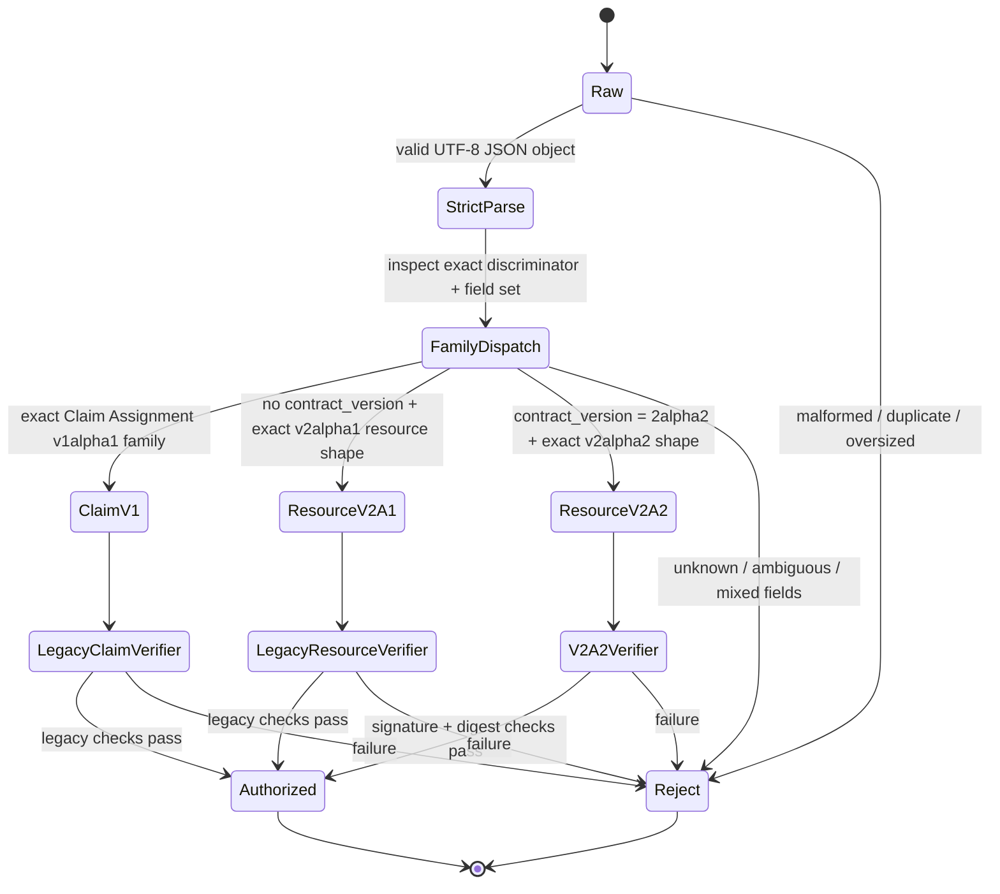

# Version Dispatch, Backward Compatibility and Trusted Signer Audit

**Version:** 0.1.0  
**Status:** SOURCE AUDIT / DESIGN NOT ACCEPTED  
**As-of:** 2026-11-03  
**Gates:** G2 OPEN; G3 OPEN

## 1. Version families observed

The repository contains distinct assertion families. They must not be conflated:

| Contract | Source | Purpose | Version signal | Existing behavior |
|---|---|---|---|---|
| Worker Claim Assignment v1alpha1 | `contracts/worker-claim-assignment.schema.v1alpha1.json` | Tenant-neutral worker assignment/claim capability | Its own v1alpha1 contract | Used by legacy `claim_next_v1` reference path |
| Worker Resource Assertion v2alpha1 | `contracts/worker-resource-assertion.schema.v2alpha1.json` | Resource-scoped Job/Outbox/Receipt/DLQ operations | `v=2`, no `contract_version`, no request_digest/idempotency_key in the legacy field set | Used by legacy `verify_v2` / `authorize_v2` |
| Worker Resource Assertion v2alpha2 | `contracts/worker-resource-assertion.schema.v2alpha2.json` | Digest-bound resource assertion | `v=2` plus required `contract_version="2alpha2"`, `idempotency_key`, `request_digest` | Independent verifier helper; not wired into action handlers |

The numeric `v=2` alone cannot distinguish v2alpha1 from v2alpha2. The explicit `contract_version` is therefore security-relevant, not decorative metadata.

## 2. Verified compatibility differences

The v2alpha1 schema requires issuer, kid, tenant, subject, audience, action, job, resource, session, owner, epoch, operation ID, iat, exp and nonce. It does not require `contract_version`, `idempotency_key` or `request_digest`.

The v2alpha2 schema requires all of those core identity fields plus `contract_version="2alpha2"`, `idempotency_key` and `request_digest`. It also introduces a separate canonical Request Envelope and typed operation-arguments digest.

The v2alpha1 schema has `additionalProperties:false`. Adding v2alpha2-only fields to a legacy token must not be silently accepted by legacy validation. Conversely, a v2alpha1 token must not pass the v2alpha2 verifier because required v2alpha2 fields are absent.

The PR #15 trusted signer design explicitly states:
- v2alpha1 verifier remains unchanged;
- v2alpha1 requires its original field set and rejects v2alpha2-only fields;
- v2alpha2 requires contract_version=2alpha2, idempotency_key and request_digest;
- no “try v2alpha2 then fallback to v2alpha1” behavior is allowed;
- a v2alpha1 token cannot authorize a v2alpha2 action or digest-bound handler.

This is a design requirement, not evidence that a common dispatcher is implemented.

## 3. Candidate fail-closed dispatch state machine

Candidate dispatch rules:
1. Parse only the raw assertion envelope and strict field set before choosing a verifier.
2. Select exactly one assertion family.
3. Reject mixed discriminator/field combinations.
4. Never try a second verifier after the selected verifier fails.
5. Action entry points must enforce the exact family allowed for that operation during the migration period.
6. Preserve old verifier functions and semantics for existing legacy callers until a separately approved compatibility migration.

The exact API shape and how a caller indicates which operation family it is invoking remain OPEN.

## 4. Version compatibility matrix

| Input assertion | Legacy Claim Assignment entry | Legacy resource action entry | v2alpha2 action entry |
|---|---|---|---|
| Claim Assignment v1alpha1 | Accept only its existing rules | Reject | Reject |
| Resource Assertion v2alpha1 | Reject | Accept only its existing rules | Reject |
| Resource Assertion v2alpha2 | Reject | Reject | Accept only after v2alpha2 integration |
| Unknown version/discriminator | Reject | Reject | Reject |
| Mixed legacy + v2alpha2 fields | Reject | Reject | Reject |
| v2alpha2 signature/digest invalid | N/A | Reject; no fallback | Reject |

## 5. Cross-version threat model

- **Downgrade:** attacker removes `contract_version` or digest fields and hopes a v2alpha2 operation falls back to legacy v2alpha1. Expected: reject at the v2alpha2 action entry; never invoke legacy verifier.
- **Upgrade confusion:** legacy entry receives a v2alpha2 token. Expected: legacy exact-field validation rejects unknown v2alpha2 fields.
- **Cross-version replay:** same nonce/token or operation is replayed through another version's action entry. Expected: entry family mismatch rejects; shared nonce uniqueness policy must additionally prevent a second accepted operation.
- **Action confusion:** a valid v2alpha1 capability for one action is presented to another action. Expected: exact action and resource mapping rejects.
- **Partial parsing:** discriminator read from a lossy jsonb conversion after duplicate-key collapse. Expected: strict raw parser rejects duplicates before version dispatch.
- **Verifier fallback:** v2alpha2 signature/digest failure followed by v2alpha1 verification attempt. Expected: forbidden.
- **Mixed-family field smuggling:** add `request_digest`/idempotency fields to a legacy assertion or omit them from v2alpha2. Expected: reject.

## 6. Backward compatibility acceptance tests

- Golden legacy v2alpha1 tokens still pass/fail exactly as before on legacy entry points.
- The v2alpha1 field set remains unchanged; v2alpha2-only fields are rejected.
- Claim Assignment v1alpha1 remains separate from Resource Assertion v2alpha1.
- v2alpha2 requires explicit discriminator and all required fields.
- Unknown discriminator, absent discriminator on v2alpha2 entry, duplicate discriminator, duplicate version fields and mixed fields reject.
- No verifier fallback occurs after signature, time, key, action, resource or digest failure.
- Same nonce across versions follows the accepted shared uniqueness policy.
- Existing PR #13 legacy tests remain unchanged and pass on their baseline.
- Cross-version replay tests run with independent DB connections and persisted-state snapshots.

## 7. Trusted Signer source facts

The PR #15 signer design describes a trusted ingress path:
1. receive raw UTF-8 request bytes;
2. reject duplicate keys and malformed Unicode;
3. resolve trusted defaults before digest generation;
4. validate action arguments and resource/action relationships;
5. construct the normalized Request Envelope;
6. calculate canonical bytes and SHA-256;
7. place digest in v2alpha2 Claim;
8. serialize deterministic Claim bytes and sign those exact bytes with Ed25519;
9. pass signed assertion and same normalized business arguments to Store.

It states that the signing private key must not be exposed to untrusted Runtime code and that Store must independently rebuild operation arguments from actual typed SQL parameters.

This is a design description; no trusted signer implementation is present in the audited branch.

## 8. Key registry facts and open issues

The disposable v2alpha2 verifier expects an `issuer_keys` table with `kid`, `issuer`, `public_key`, `not_before`, `not_after` and `revoked_at`. The verifier lookup matches both issuer and kid and checks active time/revocation state.

The legacy reference fixture similarly stores public keys only; the issuer private key is held in the test process. The earlier crypto options document prefers Ed25519 and identifies pgsodium as a self-hosted PostgreSQL candidate, with deployment/provider compatibility unresolved under DEC-14.

Open questions:
- Who authorizes an issuer and how is issuer identity bootstrapped?
- Is `kid` globally unique or unique only within issuer? Current fixture uses kid as primary key.
- How are key rotation overlap windows and old-key retirement defined?
- Is revocation immediate, transaction-snapshot, or bounded-staleness?
- Can ordinary Runtime read public key rows? Should it need to?
- Who can insert/update/revoke issuer keys and how is that operation audited?
- What happens if key revocation races a request that verified just before transaction start?
- How are compromised issuer keys and affected operation IDs investigated?
- Is key registry local to the database or resolved by a trusted signer/gateway?

No private key is to be stored in ordinary Runtime or PostgreSQL application tables. No production key custody mechanism is selected.

## 9. G2/G3 gate conclusion

G2 remains OPEN because no common fail-closed dispatcher is implemented and the full legacy behavior matrix is not yet proven. G3 remains OPEN because the trusted signer, issuer enrollment, rotation/revocation operations and database key registry privilege boundary are not accepted.

## Change history

- 2026-11-03: Initial version dispatch and signer trust-boundary audit.
