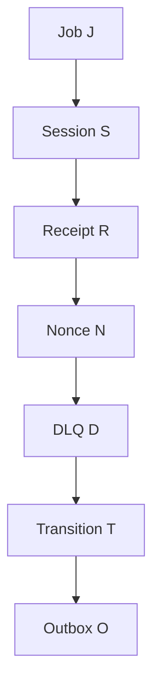

# Action Lock Dependency Graph and Deadlock Review

**Version:** 0.1.0  
**Status:** CANDIDATE ORDER / NOT ACCEPTED  
**As-of:** 2026-11-03  
**Gate:** G8 OPEN

## 1. Review rule

A lock order is accepted only after all explicit row locks, foreign-key checks, unique-index arbitration, advisory locks, trigger side effects and nested function calls are included. A list of SELECT FOR UPDATE statements alone is not a complete wait-for graph.

## 2. Candidate global lock rank

The following is a candidate ordering to test, not an accepted specification:

1. **J — Job** (source Job rows, sorted by stable composite key)
2. **S — Session** (tenant/session, sorted)
3. **R — Receipt** (tenant/action/idempotency key or receipt ID, sorted)
4. **N — Nonce** (issuer/kid/nonce unique key, sorted)
5. **D — DLQ item** (tenant/DLQ ID, sorted)
6. **T — Transition** (append-only unique transition identity)
7. **O — Outbox** (tenant/event ID, sorted)

A transaction may skip a class. If it touches multiple rows in a class, it must acquire them in a deterministic order. Any implicit FK or unique-key lock that violates the rank must be identified and either reordered or justified.

## 3. Candidate per-action acquisition paths

| Action | Candidate lock path | Forbidden reverse edge |
|---|---|---|
| Job Complete | J → S → R → N → T → O | No Receipt/Nonce lock before Job/Session if any later Job/Session lock remains |
| Job Fail | J → S (if required) → R → N → D (if terminal) → T → O | No DLQ/Outbox then Job |
| Job Retry | J → S (only if required) → R → N → T → O | No Receipt/Nonce then Job |
| Job Renew | J → R → N; T/O only if contract requires event | No Receipt/Nonce then Job |
| Job Dead Letter | J → R → N → D → T → O | No DLQ then source Job |
| Receipt Reconcile | R only; no locked Job/Session afterward | R → J or R → S is forbidden under this candidate order |
| Outbox Dispatch | R (if receipt required) → N → O | O → J/S/R/N is forbidden |
| Outbox Ack | R (if receipt required) → N → O | O → J/S/R/N is forbidden |
| DLQ Replay (deferred action) | Source J (if locked) → R → N → D; create new Job row after source/DLQ authorization | D → source J is forbidden |

Receipt Reconcile should remain read-only unless an explicit repair action is designed. If repair requires locking Job/Session, it must acquire those locks before Receipt, or become a distinct action with a reviewed order.

Outbox dispatch/ack should not lock Job or Session rows. If event payload validation needs Job state, use immutable event snapshot fields or a separately reviewed read-only consistency check; do not add reverse locks.

## 4. Wait-for graph

Under the candidate rank, allowed wait edges point only from a lower-ranked lock class to a higher-ranked class:

If every transaction follows this acyclic rank and no trigger/function introduces a reverse edge, the lock-class graph is acyclic. This is a structural argument only; it does not prove actual SQL behavior until implicit index/FK/trigger edges are inventoried and concurrency tests run.

## 5. Potential cycle patterns to prohibit

### Cycle A — Receipt reconciliation locks Job after Receipt

- Transaction A: Complete locks Job, then waits for Receipt.
- Transaction B: Reconcile locks Receipt, then waits for Job.
- Wait-for cycle: A holds Job → waits Receipt; B holds Receipt → waits Job.

Mitigation: reconcile is read-only and Receipt-only; any repair uses a separate reviewed transaction/operation or acquires Job before Receipt.

### Cycle B — DLQ replay locks DLQ before source Job

- Transaction A: Dead Letter locks Job, then waits for DLQ uniqueness/row.
- Transaction B: Replay locks DLQ, then waits for source Job.
- Wait-for cycle: A holds Job → waits DLQ; B holds DLQ → waits Job.

Mitigation: source Job lock before DLQ, or redesign replay to avoid locking the source Job. Never invert the edge.

### Cycle C — Outbox Ack locks Outbox then Receipt

- Transaction A: Job action locks Receipt then waits for Outbox event uniqueness.
- Transaction B: Ack locks Outbox then waits for Receipt.
- Wait-for cycle: A holds Receipt → waits Outbox; B holds Outbox → waits Receipt.

Mitigation: if Ack has Receipt, reserve/lock Receipt before Outbox. Otherwise do not touch Receipt.

### Cycle D — Different multi-row key ordering

- Two transactions lock multiple Jobs/Sessions/Receipts/Outbox events in opposite order.
- Mitigation: sort composite keys and acquire all rows in deterministic ascending order before mutation.

## 6. Unique-index and FK arbitration edges

The lock inventory must include:
- Receipt unique index `(tenant_id, action, idempotency_key)`;
- Receipt unique index `(tenant_id, operation_id)`;
- Nonce unique key (final scope undecided);
- Transition unique identity;
- Outbox event unique identity;
- DLQ source Job/epoch uniqueness if selected;
- foreign-key checks from Receipt/Transition/Outbox/DLQ to Job/Session;
- any trigger that touches another table;
- advisory locks or transaction-scoped locks if introduced.

An INSERT can block on an uncommitted conflicting unique key even without an explicit SELECT FOR UPDATE. That conflict is a lock edge in the graph.

## 7. Concurrency test obligations

- Acquire same Job through Complete vs Fail/Retry/Renew/Dead Letter.
- Acquire Job + Session with competing expected revisions.
- Compete same Receipt key and same operation ID on independent connections.
- Compete Nonce key across action/version/tenant.
- Dead Letter vs DLQ Replay on the same source Job.
- Receipt Reconcile during a pending operation.
- Dispatch vs Ack vs lease reclaim on same event.
- Two transactions touching multiple resources in reverse caller order.
- Inject lock timeout/deadlock and verify whole transaction rollback.
- Inspect pg_locks/wait events during deterministic barriers to compare observed waits with the graph.

## 8. Gate conclusion

G8 remains OPEN. The candidate order provides a review framework, not proof. No lock order is accepted until every action's source SQL, implicit FK/unique-index edge and concurrency behavior has been reviewed.

## Change history

- 2026-11-03: Initial lock graph and potential cycle review.
