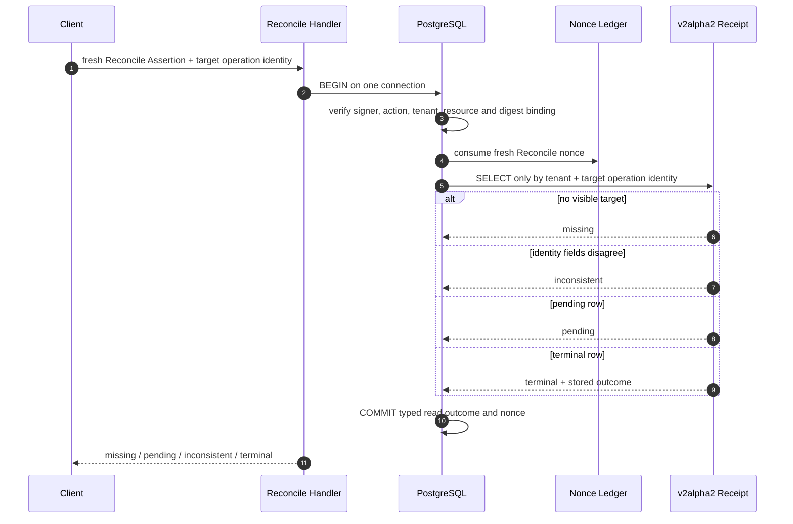

# R03.52.7.3.11.4 — Atomic Unit-of-Work Formal Model

**Status:** FORMAL TARGET MODEL / IMPLEMENTATION NOT PRESENT / NOT ACCEPTED  
**Baseline:** PR #20 HEAD `a9394870164bba5971ffa82b15c83d7e9b9cfc47`

## 1. Evidence boundary

The repository contains a language-neutral UnitOfWork Protocol in `runtime/store_protocol.py:180-210`, legacy PostgreSQL transaction references, an independent v2alpha2 digest/verifier helper and an independent Receipt helper. It does not contain a v2alpha2 business Handler or production Store Adapter joining these components.

The model below is a recommended target, not a description of a currently implemented call chain. Database connection, transaction isolation, locks and outcomes are therefore NOT VERIFIED for v2alpha2.

## 2. Required invariants

1. A committed nonce is single-use across transactions. Reusing the exact consumed Assertion/nonce returns ASSERTION_REPLAYED, never Receipt success.
2. A correct business retry preserves contract_version, action/resource, tenant, operation_id, idempotency_key, arguments and digest, but signs a fresh Assertion with a fresh nonce.
3. A fresh nonce may arbitrate against an existing Receipt and return a stored terminal outcome without repeating mutation.
4. Nonce consumption, Receipt reservation/finalization, business mutation, Transition and Outbox insertion for a mutating operation commit or roll back together.
5. Reconcile is SELECT-only for the target Receipt and never reserves/finalizes or writes Job, Session, Transition, Outbox or target Receipt.
6. A connection with uncertain transaction state is discarded. An unknown COMMIT outcome is not treated as rollback.
7. Outbox relay is post-commit and at-least-once; consumers deduplicate by immutable event_id.

## 3. Recommended transaction flow (requires approval)

The key ordering rule is **Nonce consumption before Receipt success arbitration**. Otherwise an exact replay could be converted into a duplicate Receipt response.

```mermaid
sequenceDiagram
    autonumber
    participant C as Client
    participant H as Handler
    participant V as Assertion/Digest Verifier
    participant DB as PostgreSQL transaction
    participant N as Nonce Ledger
    participant R as Receipt
    participant J as Job/Session
    participant O as Transition/Outbox
    participant L as Outbox Relay

    C->>H: Signed Assertion + immutable Request Envelope
    H->>V: Parse, closed-claim validation, signature and digest verification
    V-->>H: Verified typed binding (or reject)
    H->>DB: BEGIN on one connection
    DB->>DB: Revalidate trusted issuer/key state under approved trust snapshot
    DB->>N: INSERT unique (issuer,kid,nonce)
    alt nonce already committed
        N-->>DB: uniqueness conflict
        DB-->>H: ASSERTION_REPLAYED; ROLLBACK
        H-->>C: ASSERTION_REPLAYED
    else fresh nonce
        N-->>DB: nonce reserved in current transaction
        DB->>R: Reserve/arbitrate tenant+action+idempotency key
        alt same key, different digest/identity
            R-->>DB: IDEMPOTENCY_CONFLICT
            DB-->>H: ROLLBACK complete write set
            H-->>C: IDEMPOTENCY_CONFLICT
        else matching terminal Receipt
            R-->>DB: stored terminal outcome
            DB->>DB: COMMIT nonce-only read/replay outcome
            H-->>C: stored outcome; no mutation
        else matching pending Receipt
            R-->>DB: typed pending
            DB->>DB: COMMIT nonce-only read outcome
            H-->>C: pending; no mutation
        else first use
            R-->>DB: newly reserved pending Receipt in this transaction
            DB->>J: Lock exact Job then related Session as action requires
            DB->>DB: Verify tenant, owner, epoch, lease, state and revision
            DB->>J: Apply business mutation
            DB->>O: Append Transition and Outbox event(s)
            DB->>R: Finalize immutable typed outcome
            DB->>DB: COMMIT
            H-->>C: committed outcome
        end
    end
    L->>DB: Claim committed Outbox row in separate transaction
    DB-->>L: event_id + payload
    L-->>C: External delivery (at-least-once; consumer deduplicates)
```

The exact lock order after nonce/Receipt arbitration remains action-specific and must be proven. The sequence does not authorize locking Job/Session in a different order in another action.

## 4. Read-only Receipt reconciliation



The target Receipt is never inserted, updated or finalized by Reconcile. Recommended rule: typed missing/pending/inconsistent/terminal outcomes commit the fresh Reconcile nonce; authentication, infrastructure or transaction failures abort and roll back that nonce. This rule requires protocol/security approval and tests. Cross-tenant absence must not disclose another tenant's Receipt.

## 5. Transaction state machine

```mermaid
stateDiagram-v2
    [*] --> Unverified
    Unverified --> Rejected: malformed / signature / digest / unsupported action
    Unverified --> TxOpen: verified request; BEGIN
    TxOpen --> ReplayRejected: nonce uniqueness conflict
    TxOpen --> NonceReserved: fresh nonce
    NonceReserved --> IdempotencyConflict: same key, different digest/identity
    NonceReserved --> ExistingTerminal: matching terminal Receipt
    NonceReserved --> ReceiptReserved: first-use reservation
    ReceiptReserved --> BusinessLocked: exact action rows locked
    BusinessLocked --> BusinessRejected: terminal business rejection policy
    BusinessLocked --> Mutated: valid transition
    Mutated --> WriteSetComplete: Transition + Outbox + Receipt finalized
    WriteSetComplete --> Committed: COMMIT acknowledged
    TxOpen --> RolledBack: known pre-commit/statement failure
    NonceReserved --> RolledBack: known transaction abort
    ReceiptReserved --> RolledBack: any write-set failure
    BusinessLocked --> RolledBack: infrastructure/invariant failure
    Mutated --> RolledBack: Transition/Outbox/Receipt failure
    WriteSetComplete --> OutcomeUnknown: connection lost during COMMIT
    OutcomeUnknown --> Reconcile: discard connection; fresh assertion/nonce
    Reconcile --> ExistingTerminal: matching terminal Receipt
    Reconcile --> RetryWithFreshNonce: missing/pending policy permits safe retry
    Reconcile --> EscalateUnknown: database cannot establish outcome
    ExistingTerminal --> [*]
    ReplayRejected --> [*]
    IdempotencyConflict --> [*]
    Rejected --> [*]
    RolledBack --> [*]
    Committed --> [*]
    EscalateUnknown --> [*]
```



Business rejection versus infrastructure failure needs an accepted typed contract. A terminal business outcome may be committed only if the action's policy explicitly defines the durable failed transition/Receipt/Outbox. Database, authorization, invariant and incomplete-write-set failures must abort the outer transaction.

## 6. Failure and crash semantics

| Failure point | Durable state requirement | Client outcome |
|---|---|---|
| Before BEGIN | No writes | Deterministic validation/authorization error |
| After BEGIN, before nonce | No writes | Known failure |
| Nonce uniqueness conflict | Existing nonce unchanged; no business writes | ASSERTION_REPLAYED |
| After nonce, before Receipt | Nonce rolls back with transaction | Known abort or retry with fresh nonce |
| After Receipt reservation | Nonce + pending reservation roll back together | Known abort |
| After Job/Session mutation | All business writes, nonce and Receipt roll back together | Known abort |
| Transition/Outbox insert failure | Entire write set rolls back | Known abort |
| COMMIT rejected definitively | Transaction aborted; discard/reset connection as required | Known failure |
| Connection loss before COMMIT reaches server | Server rollback after session termination; client may need conservative reconciliation if boundary uncertain | Do not assume unless transport proves pre-COMMIT |
| COMMIT accepted, response lost | All writes durable exactly once | TRANSACTION_OUTCOME_UNKNOWN; fresh-nonce Reconcile |
| Process crash before COMMIT | PostgreSQL rolls back uncommitted transaction | Retry only with new assertion/nonce |
| Process crash after COMMIT | Durable Receipt/Nonce/Mutation/Outbox remain | Reconcile with fresh assertion/nonce |
| Outbox delivery after commit | Delivery may repeat | Consumer inbox/event_id dedup |

## 7. Isolation, locks and connection ownership

No v2alpha2 adapter currently selects or proves an isolation level, pool, connection, or lock order. The target must use one caller-owned database connection and one explicit outer transaction. No helper may commit independently; no broker/object-store/network I/O may occur while the transaction is open.

Recommended starting point for the disposable integration proof: explicit row locks and unique constraints under READ COMMITTED, with deadlock/serialization failures mapped to known-abort retry only. This is a test candidate, not a production isolation decision. Every action needs a lock dependency graph including implicit unique-index and FK waits.

## 8. Ambiguous COMMIT

- Return TRANSACTION_OUTCOME_UNKNOWN and discard the uncertain connection.
- Never retry with the same Assertion nonce.
- Reconcile with a fresh assertion/nonce and the same target operation identity.
- Matching terminal Receipt returns the stored outcome without mutation.
- A missing Receipt does not alone prove no transaction is still in flight. A subsequent same-key retry with a fresh nonce must rely on the unique idempotency constraint to arbitrate against the in-flight transaction.
- If state remains inconclusive, preserve unknown outcome and escalate.

## 9. Proof obligations

G7/G8/G10/G11 remain BLOCKED until a real Handler/Adapter implements this flow and PostgreSQL tests prove every durable before/after snapshot, multi-connection race, crash point, COMMIT ambiguity and action-specific lock order. No formal COMMIT fault injection is run in this pre-implementation phase.
