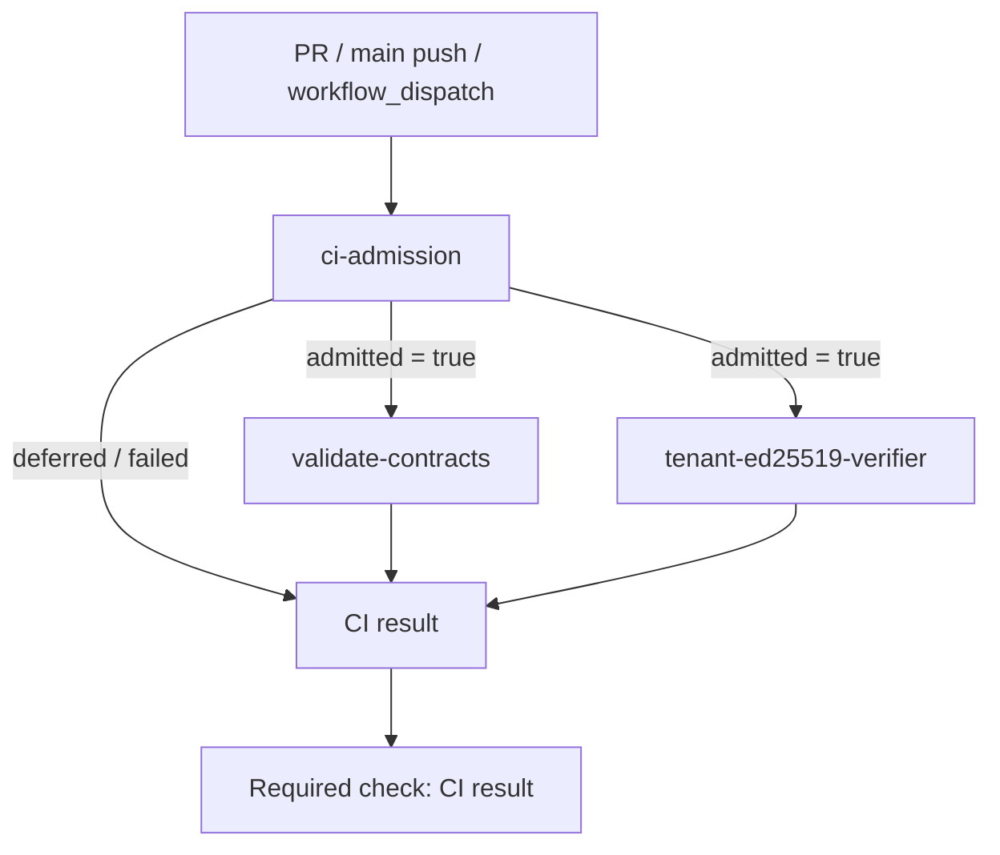
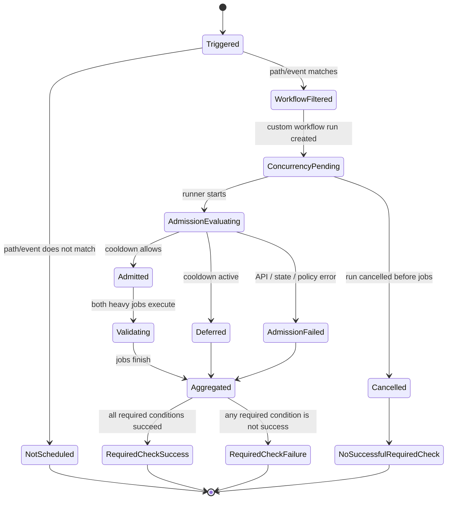

# R03-SCH-04.1 — Event & Task Classification Audit

> Audit type: read-only repository / GitHub Actions inspection  
> Repository: `liucaidong/stem-lab`  
> Audit snapshot: 2026-11-04 (Asia/Shanghai)  
> Main SHA observed: `8e749b55899d3626e39a31e1e438e3db682f5219`  
> Scope: workflow inventory, trigger/event classification, job graph, concurrency, Dependabot configuration, recent runs/jobs/checks/artifacts, admission implementation/tests, and active Ruleset.  
> Mutation boundary: no CI workflow, Dependabot configuration, branch protection, Ruleset, PR, or run was modified or re-triggered during evidence collection.

## 1. Executive findings

1. The repository currently has one event-triggered custom workflow: `.github/workflows/contract-validation.yml`. The workflow has four jobs: `ci-admission`, `validate-contracts`, `tenant-ed25519-verifier`, and the always-run aggregate `CI result`.
2. The two heavy validation jobs are intentionally parallel after admission. The aggregate depends on admission and both validation jobs, and rejects deferred, skipped, cancelled, missing, or failed validation results.
3. The custom workflow uses one global concurrency group, `stem-lab-global-ci`, with `cancel-in-progress: false` and `queue: single`. This is not a durable task queue and must not be treated as FIFO or as a guarantee that every pending run will execute.
4. Dependabot dynamic update runs are a separate event/workflow family. Eight dynamic runs were observed in the recent 100-run window, all on the main SHA and all successful. They do not inherit the custom workflow's concurrency group or the 300-second admission gate.
5. The repository-wide artifact admission marker has a one-day retention. The implementation requests only one matching artifact (`per_page=1`), relies on artifact metadata timestamps, and does not persist a task queue, reservation ledger, or replayable deferred-task record. It is a cooldown marker, not a scheduler or distributed lock.
6. In the latest 100 workflow runs (2026-11-03 04:15:32Z through 21:30:04Z), 87 were PR events, 8 dynamic Dependabot events, 4 push events, and 1 manual dispatch. Conclusions: 86 success, 11 failure, 3 cancelled.
7. Dependabot PRs #29, #30, and #31 had cancelled workflow runs with zero jobs returned. PR #29 and #30 head commits currently have no check runs and combined commit status `pending`; they are not validated. PR #32 had a failed run because the policy test hard-codes the previous upload-artifact action SHA and rejected the Dependabot action update before admission.
8. The active main Ruleset requires the exact check context `CI result`, with strict status checks enabled. The Ruleset read succeeded; the legacy branch-protection endpoint returned 403 from the GitHub integration and is recorded as an access limitation, not as evidence that protection is absent.

**SCH.04.1 conclusion: NOT READY to alter CI.** The audit confirms material task-retention and scheduler-observability gaps. Proceed to architecture and contract design; do not implement scheduler replacement or change Rulesets in this phase.

## 2. Evidence register

### 2.1 Repository and branch

| Item | Observed value |
|---|---|
| Repository | `liucaidong/stem-lab` |
| Visibility | Public |
| Default branch | `main` |
| Main SHA | `8e749b55899d3626e39a31e1e438e3db682f5219` |
| Main branch protected flag | `true` |
| Latest repository push timestamp | `2026-11-03T21:29:56Z` |
| Active Ruleset | ID `26463757`, name `main`, enforcement `active` |

### 2.2 Workflow inventory

The `.github/workflows` directory listing returned one file:

- `.github/workflows/contract-validation.yml`
  - Workflow ID observed in runs: `404131621`
  - Display name: `Contract validation`
  - Path: `.github/workflows/contract-validation.yml`

The separate Dependabot-managed dynamic workflow appears in run metadata as `dynamic/dependabot/dependabot-updates` (workflow ID `406228978`). It is GitHub-managed and is not a repository workflow file in the inspected directory.

### 2.3 Trigger classification

| Task class | Trigger | Scope / condition | Governance boundary |
|---|---|---|---|
| PR validation | `pull_request` | opened, synchronize, reopened, ready_for_review; path filters include contracts, SQL, scripts, runtime, architecture docs, contract README and validation requirements/lock | Custom concurrency + admission apply only when event passes path filters and workflow starts |
| Main validation | `push` | `main` only, same path filters | Same custom concurrency + admission |
| Manual validation | `workflow_dispatch` | No path filter | Same custom concurrency + admission |
| Dependabot update orchestration | GitHub-managed `dynamic` | Dynamic Dependabot update jobs | Separate from custom workflow concurrency and admission |
| Dependabot PR validation | `pull_request` | Dependabot PRs whose changed paths match the workflow filters | Enters the custom workflow; competes in the same global concurrency/admission domain as other custom CI |

The custom workflow's PR and push path filters include `scripts/**` and the workflow file itself. Therefore the observed Dockerfile, Node benchmark lock/package, and workflow action update PRs are within the intended path scope.

### 2.4 Job dependency graph



- `validate-contracts` and `tenant-ed25519-verifier` both depend on `ci-admission` and run in parallel when admitted.
- `ci-result` uses `if: always()` and aggregates the admission result/output plus both validation job results.
- `scripts/ci_result.py` treats a deferred admission as non-success; it requires both validation jobs to be present and conclude `success`.
- The workflow-level permission default is `{}`; job permissions are explicitly scoped. No permission expansion was made.

### 2.5 Concurrency configuration

Observed workflow configuration:

```yaml
concurrency:
  group: stem-lab-global-ci
  cancel-in-progress: false
  queue: single
```

This is a single concurrency group for custom workflow runs. It does not cover GitHub-managed dynamic Dependabot runs. The `queue: single` setting is not a durable FIFO queue: it provides no application-owned task ledger, no acknowledgement/replay protocol, and no guarantee that every pending task is eventually executed. A cancelled run must remain a non-success outcome.

### 2.6 Dependabot configuration

Observed `.github/dependabot.yml`:

| Ecosystem | Directory | Cadence | Open PR limit | Group |
|---|---|---:|---:|---|
| github-actions | `/` | weekly | 2 | minor + patch |
| pip | `/` | weekly | 2 | minor + patch |
| docker | `/scripts/docker` | weekly | 2 | minor + patch |
| npm | `/scripts/benchmarks/store-driver-node` | weekly | 2 | minor + patch |

Facts:
- All four ecosystems are weekly.
- Each ecosystem has `open-pull-requests-limit: 2`.
- Only minor and patch updates are grouped.
- Major updates are not grouped by these definitions; they can still create individual PRs within the ecosystem limit.
- The current configuration does not express a separate approval/validation workflow for major database/runtime upgrades, nor a cross-ecosystem global PR cap.

## 3. Recent workflow-run evidence

### 3.1 Sample window and aggregate

The repository Actions API reported `total_count=533`. The first page returned 100 most recent runs, from `2026-11-03T04:15:32Z` to `2026-11-03T21:30:04Z`.

| Dimension | Count in returned 100 |
|---|---:|
| `pull_request` | 87 |
| `dynamic` | 8 |
| `push` | 4 |
| `workflow_dispatch` | 1 |
| Success | 86 |
| Failure | 11 |
| Cancelled | 3 |

This is a bounded recent sample, not a complete analysis of all 533 runs. Older pages were not included in this phase.

### 3.2 Dependabot burst observed

Four Dependabot PRs were created in a short interval:

| PR | Update | Head SHA | Run ID | Run conclusion |
|---|---|---|---:|---|
| #29 | Docker PostgreSQL 17.11 → 18.4 (major) | `0da65df7e40832d1bd9116febda35c8f3e2a7803` | `41722065653` | cancelled |
| #30 | npm `pg` 8.16.3 → 8.23.1 (minor) | `b49b165d8b7a73679a297b5264ddbf16013d8f0d` | `41722127811` | cancelled |
| #31 | GitHub Actions `setup-python` 7.0.0 → 7.1.0 (minor) | `2f18c7f3ca8c5d108cd472d753db97dc80b3d2e1` | `41722331190` | cancelled |
| #32 | GitHub Actions `upload-artifact` 6.0.0 → 7.0.2 (major) | `06c7c7508ed525dc81d0bb2d65294a0a169310c4` | `41722344375` | failure |

All four PRs were open at audit time. The cancelled runs for #29, #30, and #31 returned zero jobs from the workflow-run jobs endpoint. The run metadata confirms `cancelled`, but the connector did not expose a cancellation reason for those runs; attribution specifically to concurrency replacement remains an inference, not a proven fact.

### 3.3 PR #29 and #30 check state

For both head commits:
- `check-runs` endpoint returned `total_count=0`.
- Combined commit status endpoint returned `state=pending` with an empty statuses list.
- Workflow run conclusion is `cancelled`; jobs endpoint returned zero jobs.

Therefore neither PR has a completed successful `CI result` check in the inspected evidence. Cancelled must not be interpreted as passed. Neither PR is eligible for merge.

### 3.4 PR #32 concrete failure

Run:
- Run ID: `41722344375`
- Head SHA: `06c7c7508ed525dc81d0bb2d65294a0a169310c4`
- Job ID: `126218194250` (`ci-admission`)
- Job conclusion: `failure`

The job log shows the policy verification step failed with:

```text
CI workflow policy violation: ci-admission must upload the marker artifact only after admission
```

The PR changes the `actions/upload-artifact` reference to the v7 commit SHA `cf430e030ddbb5b0abf93d22962f4752f3646cd9`. The main-branch static policy test currently hard-codes the prior v6 SHA `b7c566a772e6b6bfb58ed0dc250532a479d7789f` in its expected upload step. This is a policy/test compatibility failure before admission, not evidence that the new action itself failed at runtime. The aggregate `CI result` job also failed; both heavy validation jobs were skipped.

### 3.5 Main push and dynamic Dependabot runs

Main push:
- Run ID: `41721958066`
- SHA: `8e749b55899d3626e39a31e1e438e3db682f5219`
- Event: `push`
- Conclusion: `success`
- Jobs: `ci-admission`, `validate-contracts`, `tenant-ed25519-verifier`, `CI result` all succeeded.
- Both heavy validation jobs ran in parallel after admission.

Dynamic Dependabot:
- Eight dynamic runs (workflow ID `406228978`) were created between `2026-11-03T21:27:29Z` and `21:27:34Z`.
- All eight used main SHA `8e749b55899d3626e39a31e1e438e3db682f5219`.
- Each had one `Dependabot` job; all eight concluded `success`.
- They overlapped the main custom CI run in time and were not serialized by `stem-lab-global-ci`.

This confirms the custom global concurrency/admission mechanism does not govern the dynamic Dependabot workflow family.

## 4. Admission implementation and artifact semantics

### 4.1 Current implementation facts

Files inspected:
- `scripts/ci_admission.py`
- `scripts/test_ci_admission.py`
- `scripts/ci_result.py`
- `scripts/test_ci_result.py`
- `scripts/validate_ci_workflow_policy.py`
- `scripts/test_ci_workflow_policy.py`

Observed constants and behavior:
- `COOLDOWN_SECONDS = 300`.
- Marker name: `stem-lab-ci-admission`.
- Marker is uploaded only after admission succeeds.
- Marker artifact retention is one day.
- Admission retrieves the current run's `created_at`, queries repository artifacts by marker name with `per_page=1`, and compares timestamps.
- Admission errors fail closed.
- Existing unit tests cover first run, 299/300/301-second boundaries, an older queued event timestamp, timezone normalization, and rejection of timezone-naive timestamps.
- Aggregate tests cover deferred, admission failure, missing output/result, failed validation, skipped validation, and cancelled validation.

### 4.2 Observed artifact

For successful main run `41721958066`, the run artifact listing contained:
- `stem-lab-ci-admission`, artifact ID `13272572224`, created `2026-11-03T21:27:35Z`, expires `2026-11-04T21:27:33Z`.
- `store-driver-pool-benchmark-smoke`, artifact ID `13273167222`, created `2026-11-03T21:29:56Z`, expires `2026-11-10T21:29:55Z`.

Cancelled PR #29 and #30 runs had no artifacts listed.

### 4.3 Limitations and risks

1. **Not a queue:** there is no durable task record for deferred work, no FIFO sequence, no worker claim/acknowledgement, and no replay operation.
2. **Artifact is not a distributed lock:** it is an expiring metadata marker. It does not provide an atomic compare-and-set transaction across independent workflows.
3. **Retention dependency:** the marker expires after one day. After expiry or deletion, the gate can admit a new run without historical cooldown evidence.
4. **Single-item query assumption:** the code requests `per_page=1` and applies `max(created_at)` only to the returned page. It does not paginate or validate server-side ordering.
5. **No explicit expired-artifact filtering:** the implementation does not inspect an artifact's `expired` field.
6. **Timestamp semantics:** the comparison uses workflow run `created_at`, not a durable scheduler enqueue timestamp or a confirmed task sequence number. A run delayed in concurrency can be judged using an old creation timestamp.
7. **No explicit retry/backoff:** API failures are converted to fail-closed errors; there is no dedicated handling for 429/5xx, Retry-After, bounded retries, or jitter.
8. **No task idempotency ledger:** there is no persistent task identity keyed by event, PR, head SHA, workflow, and validation contract version.
9. **No scheduler observability:** there is no authoritative state for queued/deferred/claimed/retried/expired tasks or a durable cancellation reason.
10. **No recovery guarantee:** artifact loss, retention expiry, run cancellation, or scheduler interruption does not automatically reconstruct pending work.

The existing 300-second mechanism is therefore a rate-limit/admission heuristic only. Its boundary tests are useful and should be retained as unit-level behavior if desired, but it must not be represented as reliable scheduling or task preservation.

## 5. Required check and Ruleset evidence

Ruleset read:
- ID: `26463757`
- Name: `main`
- Target: `branch`
- Enforcement: `active`
- Required status check: `CI result`
- `strict_required_status_checks_policy: true`
- Required PR rule enabled.
- Required review thread resolution enabled.
- Bypass actors: empty list.

The main SHA's check-runs endpoint showed `CI result` = `success` for run `41721958066`. No Ruleset changes were made.

The legacy endpoint `GET /branches/main/protection` returned HTTP 403 (`Resource not accessible by integration`). This is a connector permission limitation; the active Ruleset endpoint was readable and provides the required-check evidence available in this audit.

## 6. Task lifecycle model: current observed behavior



This diagram describes the current workflow's observable control flow, not a durable queue state machine. In particular, `ConcurrencyPending` has no application-owned persistent record or guaranteed FIFO drain.

## 7. Defect register

| ID | Severity | Finding | Evidence / impact |
|---|---|---|---|
| SCH04-01 | Critical | Task retention is not guaranteed | Three Dependabot PR runs cancelled before jobs; no durable replay queue |
| SCH04-02 | High | Custom CI does not govern dynamic Dependabot runs | Eight dynamic runs overlap main validation |
| SCH04-03 | High | Artifact marker is not a durable lock or scheduler | One-day retention; no CAS, queue sequence, task ledger, or replay |
| SCH04-04 | High | Dependabot burst can create simultaneous PR validation events | PR #29–#32 created within ~2 minutes; three runs cancelled, one failed |
| SCH04-05 | High | Required check can remain pending for cancelled pre-job runs | #29/#30 head commits have zero checks and combined status pending |
| SCH04-06 | High | Policy test pins an exact upload-artifact SHA | PR #32 failed at policy verification after action SHA update |
| SCH04-07 | Medium | No explicit API retry/backoff contract | 429/5xx currently fail closed without scheduler recovery |
| SCH04-08 | Medium | Artifact query relies on a one-item page and assumed ordering | No pagination or ordering assertion |
| SCH04-09 | Medium | No task-level lifecycle observability | No durable queued/deferred/retry/cancel reason state |
| SCH04-10 | Medium | Dependabot limits are per ecosystem, not repository-wide | Four ecosystems can each produce PRs and dynamic jobs in one update window |
| SCH04-11 | Medium | Major-version governance is not separately encoded | Major updates are ungrouped but no dedicated major-update policy is expressed |
| SCH04-12 | Low | Legacy branch-protection endpoint unavailable to connector | Ruleset is readable; branch-protection-specific details remain unverified |

## 8. Confirmed facts vs. inference

### Confirmed facts
- Main SHA is `8e749b55899d3626e39a31e1e438e3db682f5219`.
- Main is reported protected; active Ruleset requires strict `CI result`.
- One repository workflow file was listed.
- Workflow event filters, job dependencies, concurrency, and job permissions are present in the inspected YAML.
- The first page of 100 recent runs has the event and conclusion distribution listed above.
- Eight dynamic Dependabot runs completed successfully and ran outside the custom workflow.
- PR #29–#31 runs are cancelled; their jobs endpoint returned zero jobs.
- PR #29 and #30 commits have zero check runs and combined status pending.
- PR #32 failed in `ci-admission` policy verification because the expected upload-artifact SHA was stale.
- The admission marker artifact observed on the main run has one-day retention.
- The admission implementation requests one matching artifact and has no queue ledger/replay implementation.
- Ruleset #26463757 is active and requires `CI result`.

### Inferences (not asserted as facts)
- The cancellation pattern for PR #29–#31 is consistent with concurrency queue pressure, but the exact cancellation actor/reason was not exposed by the inspected run metadata.
- The observed burst demonstrates a risk of task starvation/loss under the current model; it does not prove every future run will be cancelled.
- The eight dynamic runs likely correspond to ecosystem/dependency discovery work, but the connector output did not expose a stable mapping from each dynamic run to a specific ecosystem update.

## 9. SCH.04.1 acceptance

| Requirement | Result |
|---|---|
| Inspect all custom workflow files in `.github/workflows` | PASS — one file returned |
| Inspect trigger events and path filters | PASS |
| Inspect jobs and dependencies | PASS |
| Inspect concurrency | PASS |
| Inspect Dependabot ecosystems and groups | PASS |
| Inspect recent workflow runs and classify event types | PASS — bounded first page, 100/533 |
| Inspect dynamic Dependabot runs | PASS — eight recent runs |
| Inspect PR/main/manual runs | PASS — all event types represented |
| Inspect cancelled/failure/success outcomes | PASS — reasons recorded where available; unknown causes explicitly marked |
| Inspect jobs for critical Dependabot runs | PARTIAL — zero jobs returned for cancelled runs; full jobs/logs for #32 and main run |
| Inspect artifacts and retention | PARTIAL — run-level artifact records available; repository-wide filtered ordering could not be independently verified through the connector |
| Inspect admission implementation and tests | PASS |
| Inspect Ruleset required checks | PASS |
| Inspect legacy branch protection | BLOCKED — connector returned 403 |

**Stage result: PASS WITH LIMITATIONS.** The audit is sufficient to proceed to SCH.04.2 architecture and contract design. It is not authorization to change CI or Rulesets.

## 10. Next-stage entry constraints

1. Keep `COOLDOWN_SECONDS = 300` unchanged during architecture design.
2. Do not treat `queue: single` or the artifact marker as FIFO scheduling.
3. Do not merge PR #29, #30, #31, or #32 based on cancelled/skipped/failed CI.
4. Preserve both heavy validation jobs and the stable required check name `CI result`.
5. Design must explicitly handle Dependabot dynamic runs, task deduplication, durable enqueue/claim/ack/replay, API rate limits, artifact loss, cancellation, reruns, and runner interruption.
6. Any replacement of admission/scheduling must be approved before implementation; Rulesets remain read-only absent separate authorization.
