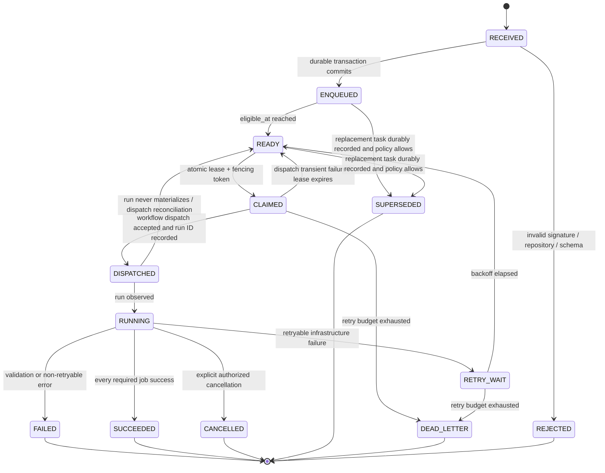

# R03-SCH-04.2 — CI Scheduling Contract

## 1. Contract status

Proposed contract; not implemented. This contract is intended to govern a future scheduler and worker implementation. It does not authorize workflow or Ruleset changes.

## 2. Task envelope

Every task MUST persist the following fields before it is acknowledged:

| Field | Requirement |
|---|---|
| task_id | Stable deterministic ID / idempotency key |
| repository_id / repository | Immutable GitHub repository identity and full name |
| task_type | `pull_request`, `main_push`, `dependabot_security`, `dependabot_version`, or `manual` |
| event_delivery_id | GitHub delivery ID where available; unique constraint |
| event_type | Original event name |
| workflow_contract_version | Version/hash of the validation contract |
| pull_request_number | Required for PR tasks |
| head_sha | Exact commit to validate; immutable |
| base_sha | Base SHA observed at enqueue time |
| ref | Exact ref used for worker checkout |
| priority | Authorized priority class |
| enqueue_sequence | Monotonic sequence assigned transactionally |
| enqueued_at / eligible_at | UTC timestamps |
| state / state_version | Current state and monotonic version |
| attempt | Dispatch/worker attempt counter |
| run_id / run_attempt | GitHub Actions run linkage |
| lease_owner / lease_expires_at / fencing_token | Worker claim ownership |
| terminal_reason | Required for every terminal non-success state |
| payload_digest | Integrity digest of normalized task payload |

No task may be acknowledged to GitHub until durable persistence succeeds.

## 3. State machine

Terminal states are immutable. Corrections create a new task or a linked retry attempt; they do not rewrite history.

## 4. Idempotency contract

1. The same task key MUST map to one logical task.
2. Repeated delivery IDs MUST be accepted idempotently and MUST NOT create additional tasks.
3. Re-delivery of a task already `SUCCEEDED` MUST return its existing result.
4. A task in `CLAIMED` or `DISPATCHED` MUST NOT be dispatched a second time unless reconciliation proves the previous dispatch did not create a run.
5. Every retry increments `attempt` and records a reason, backoff, and prior run ID.
6. Different PR numbers, different head SHAs, different validation contract versions, and different main commits are distinct tasks.
7. No cross-PR deduplication is permitted.
8. Same PR with a new head SHA does not overwrite the old task. The old task may be explicitly marked `SUPERSEDED` only after the new task is durably enqueued and the old task is not already executing, unless an operator explicitly cancels it.

## 5. Priority and fairness contract

Priority order:
- P0: main push validation.
- P1: human PR validation and Dependabot security updates.
- P2: Dependabot major updates.
- P3: Dependabot minor/patch updates.
- P4: non-urgent manual validation.

Within a priority, order by durable enqueue sequence. Aging MUST promote tasks that exceed the configured maximum wait. A priority burst MUST NOT starve lower classes indefinitely.

A task already executing is non-preemptive by default. Main priority affects the next free worker, not the cancellation of an active PR validation.

## 6. Concurrency and cooldown contract

- Worker concurrency is a separately configured finite integer.
- The initial global inter-start cooldown remains exactly 300 seconds.
- Cooldown creates `eligible_at`; it MUST NOT reject, discard, or mark the task successful.
- GitHub Actions `queue: max` may be used as a bounded backstop, with explicit overflow monitoring. It is not the authoritative queue.
- More than 100 pending runs in one native concurrency group can still be cancelled; the durable scheduler MUST detect and re-dispatch missing tasks.
- No workflow may use `cancel-in-progress: true` for required validation tasks.
- Native concurrency ordering is not assumed to be strict dispatch FIFO.

## 7. Retry and cancellation contract

Retryable:
- GitHub API 429, respecting `Retry-After` or rate-limit reset;
- GitHub API 5xx;
- transient network failures/timeouts;
- runner lost / infrastructure failure;
- dispatch accepted ambiguously with no run observed after reconciliation window;
- worker lease expiry without terminal result.

Non-retryable by default:
- deterministic validation/test failure;
- invalid task payload/signature;
- unsupported contract version;
- policy violation requiring code/config change.

Retry behavior:
- bounded exponential backoff with jitter;
- no retry storm;
- each attempt records error class, HTTP status, run ID, timestamps, and retry decision;
- exhausted retries enter `DEAD_LETTER` and alert operators;
- manual rerun is a linked attempt, not an untracked new task.

Cancellation:
- only explicit authorized action or a documented safe supersession rule;
- cancellation reason and actor are mandatory;
- cancellation is never success;
- a cancelled required validation task is re-queued or remains blocking until a successful current-head validation exists.

## 8. Lease and fencing contract

- Claim operation MUST be atomic.
- Every claim receives a monotonically increasing fencing token.
- A worker with an expired lease or stale fencing token MUST NOT acknowledge success.
- Heartbeats extend the lease only for the current fencing token.
- Reconciler may reclaim an expired lease after verifying the linked GitHub run state.
- Duplicate workers may execute due to ambiguous dispatch, but only the current fencing token may commit task state.

## 9. API rate-limit contract

- Respect `Retry-After`, `X-RateLimit-Remaining`, and `X-RateLimit-Reset`.
- Use conditional requests / ETags where supported.
- Batch and cache repository/PR metadata.
- Do not poll at a fixed high frequency.
- Distinguish primary rate limits, secondary rate limits, abuse detection, permissions errors, and resource-not-found.
- 403 permission failures are not retried blindly.
- API read failure MUST NOT be interpreted as absence of a task or as success.
- All retries are bounded and visible.

## 10. Required-check contract

- Required context remains exactly `CI result`.
- Ruleset #26463757 is not modified by this phase.
- Worker must run the complete validation suite: `validate-contracts` and `tenant-ed25519-verifier`.
- `CI result` succeeds only when admission/dispatch authorization is valid and every required validation job concludes `success`.
- `skipped`, `cancelled`, `timed_out`, missing, stale-SHA, or unknown results are non-success.
- A worker run must be associated with the exact task SHA.
- A new task cannot inherit a prior SHA's successful check.
- No task may be considered complete solely because the scheduler dispatched it.
- The scheduler reconciler must detect a missing required check and re-dispatch or alert.

Before cutover, an integration proof MUST verify that a dispatched workflow run on a PR head ref creates the exact required check accepted by the unchanged Ruleset and does not leave a second permanently pending check.

## 11. Observability contract

Every task MUST be searchable by:
- task ID;
- repository + PR number;
- exact head SHA;
- event delivery ID;
- workflow run ID / attempt;
- task type and priority;
- state and terminal reason.

Required metrics:
- enqueue rate by task type;
- queue depth by priority;
- oldest task age;
- enqueue-to-dispatch latency;
- enqueue-to-start latency;
- execution duration p50/p95;
- cooldown wait duration;
- retry count and retry reason;
- cancellation/supersession count and actor;
- dead-letter count;
- duplicate delivery count;
- orphaned GitHub run count;
- missing required-check count;
- API 429/5xx/403 counts;
- worker lease expiry count;
- queue overflow / reconciliation repair count.

## 12. Acceptance invariants

1. Every accepted event has exactly one durable task identity.
2. Every accepted task remains queryable until terminal state.
3. A task is never silently replaced by a later task.
4. Distinct PR/head SHA tasks are never deduplicated.
5. No validation job is removed or weakened.
6. Every successful task maps to an exact SHA and a complete successful validation run.
7. A cancelled or skipped task cannot produce a successful required check.
8. API failures cannot produce false success or silent task deletion.
9. Expired artifacts do not erase queue state.
10. Runner loss and scheduler restart are recoverable.
11. Duplicate webhook delivery and workflow rerun are idempotent.
12. Ruleset and required context remain unchanged.
